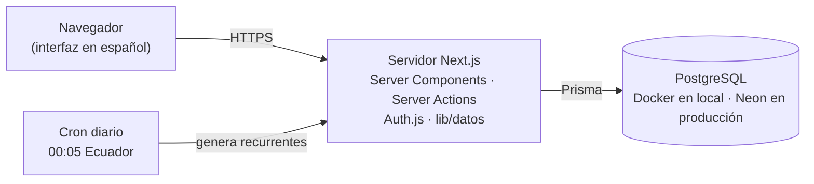

# Especificación: Kanomics, app de finanzas personales

Versión 1.1 · 24 de noviembre de 2026 · Karel

## 1. Visión y alcance

La app es una aplicación web pensada para escritorio. Arranca con un usuario y está preparada para varios. Sirve para registrar gastos e ingresos en dólares, ver métricas por día, semana, mes y año, controlar presupuestos y metas, conocer tu patrimonio, salir de deudas, buscar empleo, preparar tus deducibles y recibir recomendaciones para ahorrar, invertir y generar más ingresos. Todo el alcance se construye de una vez, incluido el panel de análisis, y operarla cuesta $0. Cada servicio usado tiene plan gratuito permanente y lo que cobra por uso queda apagado por defecto.

Principios que deben respetarse en todo el código:

- **Registrar debe tomar menos de 10 segundos.** El formulario rápido está siempre a un clic y recuerda la última categoría usada.
- **Ningún número se inventa.** Las tasas de interés, rendimientos y montos de ideas de ingreso los ingresa el usuario. La app calcula con lo que el usuario da y nunca muestra cifras de mercado fijas en el código.
- **Cada recomendación muestra su porqué.** Junto al consejo aparece el dato que lo disparó (por ejemplo, "Gastaste $84 en Entretenimiento, 40 % más que tu promedio").
- **La sección de inversión es educativa.** Toda pantalla de inversión lleva el aviso "Información educativa, no es asesoría financiera".
- **Los datos son privados.** Se guardan en PostgreSQL separados por usuario y cada uno solo ve los suyos. Ningún dato financiero se envía a servicios de terceros.

### Nombre, público e idiomas

- **Nombre:** Kanomics. Reemplaza a "Finanzas" en la landing, la pantalla de ingreso, el menú y los títulos de página.
- **Público:** personas que quieren ordenar su dinero (primero Ecuador y Latinoamérica), un grupo limitado de usuarios y reclutadores que revisan el proyecto como portafolio. Por eso la app tiene que verse y funcionar a nivel profesional, con costo $0.
- **Idiomas:** español (principal) e inglés. La landing ya tiene las dos versiones: `/` en español y `/en` en inglés, con selector de idioma. La app por dentro se traduce en la fase 4c, con los textos sacados a diccionarios.

### Paquetes de país

La app no se encierra en Ecuador. Se separa en dos capas:

- **Lo general**, que sirve en cualquier país: registrar, cuentas, presupuestos, metas, análisis y recomendaciones.
- **Lo local**, que llega como un **paquete de país** que el usuario elige al entrar: moneda, formato de números y fechas, zona horaria, impuestos y deducibles, seguro de depósitos y aporte a la seguridad social.

| Qué cambia por país | Ecuador (primer paquete) | Otro país |
| --- | --- | --- |
| Moneda | USD | La del país. Una sola moneda por usuario, sin conversiones |
| Formato | `$1.234,56` | El del país |
| Zona horaria | America/Guayaquil | La del país |
| Impuestos y deducibles | SRI, de 7 a 20 canastas (sección 22) | Sin módulo al inicio: la sección se oculta |
| Seguro de depósitos | Cosede, $32.000 | Se oculta o lleva su propio dato |
| Seguridad social | IESS, 9,45 % | Se configura |

Ecuador es el primer y, por ahora, único paquete. Agregar un país es escribir su paquete, no reescribir la app. Las reglas de la sección 6 sobre moneda y fechas pasan a leer el paquete del usuario en la fase 4c; hasta entonces siguen fijas en Ecuador.

### Modo demo

Cualquiera puede probar la app sin registrarse con el botón "Probar la demo":

- Cada visitante recibe su propio usuario temporal, sembrado con datos de ejemplo, y puede tocar todo.
- El cron diario borra los usuarios demo con más de 24 horas.
- Hay un límite de creación de usuarios demo para que nadie llene la base.
- Cuesta $0: usa la misma base gratuita. Los datos de la demo son de ejemplo, nunca reales.

## 2. Stack y arquitectura

El stack es de nivel producción desde el primer día: PostgreSQL, autenticación, pruebas automáticas e integración continua. La app empieza con un usuario, pero el modelo ya separa los datos por usuario para que crecer no obligue a reescribir nada.

| Capa | Herramienta | Motivo |
| --- | --- | --- |
| Framework | Next.js (App Router) con TypeScript en modo estricto | Interfaz, Server Actions y rutas de API en un solo proyecto |
| Base de datos | PostgreSQL | Tipos reales (DATE, ENUM, TIMESTAMPTZ), restricciones únicas e índices, lista para escalar |
| Acceso a datos | Prisma ORM con migraciones versionadas | Esquema tipado y cambios de base rastreables en Git |
| Entorno local | Docker Compose con PostgreSQL | La misma base en tu compu, en CI y en producción |
| Autenticación | Auth.js (NextAuth v4, la rama estable) con Google y un acceso solo para desarrollo | Sesiones JWT firmadas, con usuarios y cuentas vinculadas guardados en la base. Sin contraseñas propias que proteger |
| Interfaz | Tailwind CSS con shadcn/ui (sobre Radix) | Componentes accesibles con teclado y lector de pantalla, estilizados con los tokens de la sección 3 |
| Formularios | React Hook Form con Zod | Las mismas reglas de validación en el formulario y en el servidor |
| Gráficos | Apache ECharts con echarts-for-react | Barras, líneas, anillo, Sankey, mapa de calor de calendario y gráficos de bala, con tooltips y modo oscuro |
| Fechas | date-fns con su paquete de zonas horarias | Semanas que empiezan en lunes y zona horaria fija |
| Tareas programadas | Cron diario (Vercel Cron al desplegar) | Genera los recurrentes, toma la foto mensual del patrimonio y prepara los avisos del día, aunque nadie abra la app |
| Configuración | Variables de entorno validadas con Zod al arrancar | La app no arranca si falta una clave |
| Pruebas | Vitest para lógica, Playwright de extremo a extremo | Fórmulas y flujos principales cubiertos |
| Calidad | ESLint, Prettier, Husky con lint-staged | El código se revisa antes de cada commit |
| Integración continua | GitHub Actions | Gratis e ilimitado con el repositorio público. Corre lint, tipos, pruebas, migraciones y build en cada push |
| 3D y movimiento | three con React Three Fiber, GSAP con ScrollTrigger, Lenis y Motion | La moneda 3D de la landing se dibuja en tiempo real; GSAP dirige la coreografía del scroll y Lenis lo suaviza. Motion queda para las micro-animaciones dentro de la app. Todo gratis, cargado de forma diferida y apagado con "reducir movimiento" |
| Tipografía | Geist y Geist Mono con `next/font` | Grotesca geométrica limpia para titulares y texto; la mono para rótulos técnicos y cifras |
| Monitoreo | Sentry | Plan Developer gratuito con 5.000 errores al mes, de sobra para un usuario |
| Despliegue | Vercel Hobby con Neon Free y la dirección gratuita .vercel.app | $0 para un proyecto personal sin fines comerciales |

Las versiones exactas se fijan al crear el proyecto, tomando la estable vigente de cada paquete.



El navegador solo habla con el servidor. El servidor es el único que consulta PostgreSQL, y el cron diario le pide generar los recurrentes.

### Costo cero

La app debe costar $0 de punta a punta. Estas reglas lo garantizan:

- **Repositorio público en GitHub.** Así GitHub Actions es gratis y el código luce en tu portafolio. El archivo `.env` nunca se sube: va en `.gitignore` y la CI usa los secretos de GitHub.
- **Planes gratuitos permanentes.** Vercel Hobby, Neon Free (1 GB por proyecto, de sobra para las finanzas de una persona) y Sentry Developer.
- **Sin dominio propio.** Se usa la dirección `.vercel.app` que da Vercel.
- **Inicio de sesión solo con Google.** El enlace por correo queda fuera porque necesita un servicio de envío de emails.
- **Nada indispensable de pago.** Sentry es opcional. Si algún servicio cambia sus condiciones y empieza a cobrar, la app sigue funcionando sin él.

### Reglas de arquitectura

- **Separación por usuario.** Toda tabla con datos del usuario lleva `usuarioId`. Ninguna consulta se hace fuera de la capa `lib/datos/`, y esa capa siempre filtra por el usuario de la sesión. Así es imposible que un usuario vea datos de otro por olvidar un filtro.
- **Lógica pura.** Toda fórmula vive en `lib/calculos/` o `lib/reglas/` como función pura que recibe datos y devuelve resultados, sin tocar la base. Las páginas solo muestran lo que esas funciones devuelven.
- **Lecturas y escrituras.** Las lecturas se hacen en Server Components. Las escrituras van por Server Actions validadas con Zod y responden con errores tipados.
- **Dinero en centavos.** Todo monto es entero en centavos en la base y en la lógica. Solo se convierte a dólares al mostrarlo.
- **Siembra por usuario.** Al crearse un usuario se le siembran sus categorías (sección 4), sus ajustes por defecto, la cuenta Efectivo y las ideas semilla (sección 13) dentro de una transacción. Los parámetros del SRI son globales y se siembran una sola vez.

### Acceso de desarrollo

Mientras construyes la app no hace falta configurar Google ni correo. La pantalla de inicio de sesión muestra un botón "Entrar como desarrollador" que entra con un usuario de prueba, usando el proveedor de credenciales de Auth.js.

- El botón y su proveedor solo se registran si `NODE_ENV` es `development` y la variable `ACCESO_DESARROLLO` vale `true`. Si falta cualquiera de las dos, el proveedor no existe y su ruta responde 404.
- El usuario de prueba pasa por la misma siembra que cualquier usuario nuevo, así que se comporta igual que uno real.
- Una prueba automatizada genera el build de producción y verifica que el botón no aparece.

### Estructura de carpetas

```
app/
  (publico)/page.tsx           Landing pública (sección 3, "Landing pública")
  (auth)/ingresar/page.tsx
  (app)/panel/page.tsx         Panel de inicio
  (app)/movimientos/page.tsx
  (app)/presupuestos/page.tsx
  (app)/metas/page.tsx
  (app)/recomendaciones/page.tsx
  (app)/inversion/page.tsx
  (app)/ingresos/page.tsx
  (app)/ajustes/page.tsx
  (app)/cuentas/page.tsx
  (app)/patrimonio/page.tsx
  (app)/deudas/page.tsx
  (app)/empleo/page.tsx
  (app)/revision/page.tsx
  (app)/prestamos/page.tsx
  (app)/impuestos/page.tsx
  (app)/analisis/page.tsx        Panel de análisis
  api/auth/[...nextauth]/route.ts
  api/cron/diario/route.ts      Recurrentes, foto mensual y avisos. Protegida con CRON_SECRET
components/
lib/
  auth/                        Configuración de Auth.js
  datos/                       Única capa que consulta la base
  calculos/                    Fórmulas puras
  reglas/                      Motor de recomendaciones, una regla por archivo
  insights/                    Frases y puntaje del panel de análisis
  dinero.ts                    Centavos y formato
  fechas.ts                    Zona horaria y períodos
  env.ts                       Validación de variables de entorno
prisma/
  schema.prisma
  migrations/
  seed.ts
tests/                         Vitest
e2e/                           Playwright
docker-compose.yml
.github/workflows/ci.yml
```

## 3. Diseño visual

La paleta elegida es la A, azul tinta, con modo claro, modo oscuro y opción de seguir el sistema. Verde, rojo y ámbar quedan reservados para significado y nunca se usan como color de marca.

### Tokens de color

Cada color se define una sola vez como variable CSS y todos los componentes usan la variable, nunca el hexadecimal directo.

| Token | Uso | Claro | Oscuro |
| --- | --- | --- | --- |
| `--fondo` | Fondo de la página | #EEF2FA | #0B1220 |
| `--superficie` | Tarjetas y paneles | #FFFFFF | #121A2B |
| `--superficie-2` | Campos, filas en hover | #F5F7FC | #1A2438 |
| `--borde` | Líneas finas | #DCE3EF | #26324A |
| `--texto` | Texto principal | #0F172A | #E6ECF5 |
| `--texto-2` | Texto secundario | #475569 | #A3B0C5 |
| `--texto-3` | Leyendas y marcas de agua | #64748B | #7D8AA3 |
| `--marca` | Tarjeta de balance, ítem activo del menú | #1E3A8A | #1E40AF |
| `--acento` | Botones, enlaces, foco | #2563EB | #60A5FA |
| `--acento-suave` | Fondos de selección | #DBEAFE | #1E3A5F |
| `--ingreso` | Montos y etiquetas de ingreso | #15803D | #4ADE80 |
| `--ingreso-fondo` | Fondo de etiqueta de ingreso | #DCFCE7 | #12301F |
| `--gasto` | Montos de gasto, estado crítico | #B91C1C | #F87171 |
| `--gasto-fondo` | Fondo de etiqueta de gasto | #FEE2E2 | #3A1517 |
| `--alerta` | Advertencias | #B45309 | #FBBF24 |
| `--alerta-fondo` | Fondo de advertencia | #FEF3C7 | #3A2A0B |

Reglas de uso del color:

- Un monto nunca depende solo del color. El gasto lleva el signo − y el ingreso el signo +, además de su color.
- Toda alerta lleva ícono y texto. El ámbar o el rojo solos no bastan.
- Solo hay un botón primario por pantalla.

### Tipografía

- Fuente IBM Plex Sans cargada con `next/font`, con respaldo `system-ui, sans-serif`.
- Escala fija de tamaños: 12, 14, 16, 20, 28 y 36 px. El balance grande usa 36 px.
- Todas las cifras usan `font-variant-numeric: tabular-nums` para que las columnas de montos queden alineadas.

### Distribución en escritorio

- Menú lateral fijo de 240 px a la izquierda con las secciones agrupadas en bloques y el botón "Registrar" arriba.
- Contenido con ancho máximo de 1280 px, en una cuadrícula de 12 columnas con separación de 24 px.
- Ancho mínimo soportado de 1024 px. Por debajo de 1280 px el menú se reduce a íconos.
- Atajos de teclado: `N` abre el formulario de registro, `/` enfoca el buscador de movimientos y `Esc` cierra cualquier panel.
- El menú se agrupa en cinco bloques. Día a día: Inicio, Movimientos, Cuentas y Presupuestos. Futuro: Metas y plan, Patrimonio, Deudas e Inversión. Crecer: Ingresos y Empleo. Entender: Análisis y Recomendaciones. Herramientas: Revisión mensual, Préstamos, Impuestos y Ajustes.

### Dirección visual de Kanomics

Decidido el 24 de noviembre de 2026. Reemplaza a la "casa de moneda de noche" (negro y latón), que se descartó por verse barata y por asociarse a cripto y casinos.

- **Blanco y profesional.** Fondo blanco, tinta casi negra, líneas finas como estructura y un solo acento. Se ve formal por lo sobrio y un poco futurista por el titanio y el movimiento.
- **Calidad de película.** Luz de estudio sobre el metal, movimiento continuo y sin cortes, cámara que acompaña y ritmo pausado. Nada de efectos de plantilla.
- **Un solo sistema de diseño** para la landing y la app: mismos tokens, misma tipografía y componentes reutilizables. Los tokens azules de esta sección se migran a la familia de abajo antes de la fase 5.
- **Descartado:** el negro con latón, la nube difuminada de fondo, la moneda que se multiplica en muchas monedas y la alcancía de aire infantil.

| Token | Uso | Valor |
| --- | --- | --- |
| `--k-fondo` | Fondo | #FFFFFF |
| `--k-fondo-2` | Bandas y tarjetas | #F4F6F8 |
| `--k-tinta` | Texto principal y botón primario (píldora) | #0E1116 |
| `--k-tinta-2` | Texto secundario | #5B6472 |
| `--k-tinta-3` | Leyendas | #8A93A0 |
| `--k-linea` | Líneas finas | #E3E7EC |
| `--k-pizarra` | Degradado del nombre gigante | #8FA3B8 → blanco |
| `--k-acento` | Lo ahorrado: solo datos de ahorro y el trazo final | #0E9F6E |

La moneda es de **titanio cepillado** (plata fría con reflejos azulados), con acabado "proof": campo espejo y relieve escarchado.

### Landing pública

La dirección `/` (español) y `/en` (inglés) es una landing para quien no tiene sesión; quien ya entró va directo a `/panel`. Su acción principal es "Entrar con Google", con "Probar la demo" al lado.

**La idea: una historia vertical.** Se inspira en la idea, no en la ejecución, de dos sitios de referencia: el de United Carriers (un objeto viaja de arriba hacia abajo con el scroll, visto desde arriba, y cada parada del recorrido es un capítulo) y el de Airform (el producto delante del nombre gigante, calma entre efecto y efecto, ficha técnica con líneas finas). El objeto protagonista es **una sola moneda 3D** de la marca, que nunca se multiplica.

1. **Entrada.** Mientras la página termina de cargar, la moneda cae, aterriza de canto, gira como una moneda real sobre la mesa (disco de Euler) y se detiene de frente, delante del nombre KANOMICS en gigante; el nombre se escribe mientras ella se frena. Dura unos 2,5 s, se salta con scroll o clic, corre solo en la primera visita de la sesión y nunca bloquea el contenido, que ya está en el HTML.
2. **El viaje.** Al bajar, la moneda rueda por un carril central y **dibuja una línea a su paso**: por delante el camino punteado, por detrás el trazo sólido. En el capítulo del problema la línea zigzaguea (el dinero que se escapa); desde la misión va recta; al final termina en el color del ahorro. Es el mensaje: tu dinero se desparramaba y terminas ahorrándolo.
3. **Los capítulos**, a los lados del carril:
   - 01 · El problema: "El dinero no se pierde. Se escapa."
   - 02 · La misión: "Que cada dólar tenga un destino." Las tres preguntas: ¿cuánto me queda?, ¿en qué se me va?, ¿qué debería hacer?
   - 03 · Cómo funciona: tres estaciones (registrar, entender, decidir), cada una con una pantalla real de la app con datos de ejemplo. Lo que aún no está construido lleva la etiqueta "Próximamente".
   - 04 · Dónde funciona: el paquete Ecuador y la idea de los paquetes de país.
   - 05 · Privacidad.
   - 06 · Quién la hace: el creador y la **ficha técnica** para reclutadores (stack, datos, acceso, calidad, movimiento, idiomas, costo).
   - Final: "Lo que se te escapaba, ahora se queda." La moneda se posa sobre una tarjeta de inicio de sesión con "Entrar con Google" y "Probar la demo".
4. **Pie.** El nombre KANOMICS gigante dibujado en puntos, el idioma, el enlace al código y el año.

Reglas:

- **Datos de ejemplo.** Todo monto que se muestra es de ejemplo y lo dice. No hay testimonios, cifras de uso ni logos inventados. La historia del creador la escribe Karel; mientras no exista, no se inventa.
- **Textos.** Hablan de lo que hace el sistema y de su visión, nunca de números de fase.
- **Rendimiento.** La landing sale estática. El 3D se carga después del texto, con resolución limitada, y se pausa fuera de pantalla. Sin videos.
- **Accesibilidad.** Contraste AA, todo usable con teclado, y con "reducir movimiento" no hay entrada, scroll suave ni viaje: el contenido se ve completo y quieto. Funciona desde 360 px de ancho; en celular el carril pasa al borde izquierdo.
- **Sin WebGL**, la página se ve completa sin la moneda.

## 4. Categorías

La app arranca con diez categorías de gasto y cinco de ingreso, dos de ellas de sistema. Cada una tiene un color fijo que no cambia aunque cambie su tamaño o su posición en un ranking. Los colores salen de una paleta probada para que se distingan entre sí, incluso con daltonismo.

### Gastos

| Orden | Categoría | Tipo 50/30/20 | Color claro | Color oscuro |
| --- | --- | --- | --- | --- |
| 1 | Alimentación | Necesidad | #2A78D6 | #3987E5 |
| 2 | Transporte | Necesidad | #EB6834 | #D95926 |
| 3 | Vivienda y servicios | Necesidad | #1BAF7A | #199E70 |
| 4 | Salud | Necesidad | #EDA100 | #C98500 |
| 5 | Entretenimiento | Deseo | #E87BA4 | #D55181 |
| 6 | Suscripciones | Deseo | #008300 | #0CA30C |
| 7 | Ropa | Deseo | #6250D6 | #9085E9 |
| 8 | Tecnología | Deseo | #E34948 | #E66767 |
| 9 | Otros | Deseo | #898781 | #898781 |

### Ingresos

| Orden | Categoría | Color claro | Color oscuro |
| --- | --- | --- | --- |
| 1 | Pasantía o sueldo | #2A78D6 | #3987E5 |
| 2 | Freelance | #EB6834 | #D95926 |
| 3 | Ventas | #1BAF7A | #199E70 |
| 4 | Otros | #898781 | #898781 |

### Reglas de categorías

- El color de una categoría solo se usa en gráficos y en el punto de color junto a su nombre. Nunca colorea un monto, porque eso confundiría el verde de Suscripciones o el rojo de Tecnología con ingreso y gasto.
- En el gráfico de anillo los segmentos siguen siempre el orden de la tabla, no el tamaño. Ese orden es el que mantiene distinguibles los colores vecinos.
- El usuario puede renombrar categorías, cambiar su tipo 50/30/20 y crear nuevas en Ajustes. Una categoría nueva toma el primer color libre de la tabla. Si no queda ninguno libre, se muestra en gris y en los gráficos se agrupa dentro de "Otros".
- Una categoría con movimientos no se borra. Se archiva, deja de aparecer en el formulario y conserva su historial.
- Las categorías de tipo Necesidad son las que cuentan como gasto esencial para el fondo de emergencia (sección 10).

Además hay dos categorías de sistema que no se pueden borrar. "Intereses y comisiones" es de gasto, tipo Necesidad, en gris #5F5E5A (claro) y #B4B2A9 (oscuro), y la usan las deudas y las tarjetas. "Rendimientos" es de ingreso, en #EDA100 (claro) y #C98500 (oscuro), para intereses de pólizas y ganancias de inversiones.

## 5. Modelo de datos

Son treinta y una entidades propias, más las tablas que crea Auth.js. Las tablas de Auth.js conservan sus nombres en inglés (User, Account, Session, VerificationToken) para no chocar con la entidad `Cuenta`. Todas las entidades propias llevan usuarioId, salvo `ParametrosSRI`, que es global. Todo monto se guarda como entero en centavos (`montoCentavos`) para evitar errores de redondeo, y toda fecha de calendario se guarda como columna DATE de PostgreSQL con formato `AAAA-MM-DD` en la hora de Ecuador.

| Entidad | Campos | Notas |
| --- | --- | --- |
| Categoria | id, nombre, tipo (GASTO, INGRESO), clase (NECESIDAD, DESEO, vacío en ingresos), colorSlot (1 a 8 o vacío), sistema (INTERESES_COMISIONES, RENDIMIENTOS o vacío), orden, archivada | Se siembran las 15 de la sección 4 |
| Movimiento | id, tipo, montoCentavos, categoriaId, cuentaId, fecha, nota, metodoPago (EFECTIVO, DEBITO, CREDITO, TRANSFERENCIA), recurrenteId, planIngresoId, rubroSRI, conFactura, esAjuste, creadoEn, actualizadoEn | `recurrenteId` vacío si se registró a mano |
| Recurrente | id, tipo, montoCentavos, categoriaId, cuentaId, nota, frecuencia (SEMANAL, MENSUAL, ANUAL), diaSemana, diaMes, mes, fechaInicio, fechaFin, activo, ultimaGenerada | Ver sección 7 |
| Presupuesto | id, categoriaId, montoMensualCentavos, vigenteDesde (`AAAA-MM`) | Único por categoría y mes de inicio |
| Meta | id, nombre, montoObjetivoCentavos, fechaObjetivo, esFondoEmergencia, objetivoManual, prioridad, creadaEn, estado (ACTIVA, CUMPLIDA, ARCHIVADA), orden | Solo puede existir una meta con `esFondoEmergencia` |
| AporteMeta | id, metaId, montoCentavos, fecha, nota | Un monto negativo es un retiro |
| Inversion | id, tipoProducto, institucion, tipoInstitucion, cuentaId, coberturaCentavos, montoCentavos, tasaAnual, fechaInicio, fechaVencimiento, valorActualCentavos, nota | `tasaAnual` y `coberturaCentavos` los ingresa el usuario. `cuentaId` es la cuenta de donde sale el dinero al abrirla (como transferencia), para no contarlo dos veces en el patrimonio |
| PerfilRiesgo | id, respuestas, puntaje, perfil (CONSERVADOR, MODERADO, AGRESIVO), fecha | Se guarda cada intento, vale el último |
| IdeaIngreso | id, titulo, descripcion, area, habilidadesRequeridas, nivelMinimo (CUALQUIERA, ESTUDIANTE, JUNIOR, PROFESIONAL_TITULADO), horasSemanaMin, horasSemanaMax, capital (NINGUNO, BAJO, MEDIO), modalidad, tiempoPrimerCobro, canales, requisitos, pasos, esSemilla | Se siembran las ideas de la sección 13 |
| PlanIngreso | id, ideaId, estado (ACTIVO, PAUSADO, TERMINADO), pasosHechos, metaMensualCentavos, inicio | Conecta una idea con su avance |
| Ajustes | nombre, tema (CLARO, OSCURO, SISTEMA), umbralHormigaCentavos, mesesFondoObjetivo, metaIngresoExtraCentavos, plantillas, plantillasMensaje, cargasFamiliares, metaPatrimonioCentavos, fechaMetaPatrimonio, multiplicadorIndependencia, aporteIess, diaRevision, descartes, distribucionObjetivo, limiteCoberturaBancosCentavos, fechaVerificacionCobertura, porcentajeNoFacturable, colchonImprevistos, porcentajeImpuestosTarifa, ultimaCategoriaGastoId, ultimaCategoriaIngresoId, ultimaCuentaId | Uno por usuario |
| PerfilProfesional | usuarioId, profesion, nivel, habilidades, certificaciones, idiomas, horasSemana, capital, modalidad, alcance | Uno por usuario. Alimenta el puntaje de afinidad |
| Oportunidad | id, planIngresoId, cliente, contacto, montoEstimadoCentavos, etapa (PROSPECTO, CONTACTADO, PROPUESTA, NEGOCIACION, GANADA, PERDIDA), proximoSeguimiento, notas, motivoPerdida | Índice por (usuarioId, etapa) |
| Cobro | id, oportunidadId, montoCentavos, vencimiento, estado (PENDIENTE, COBRADO, VENCIDO), fechaCobro, movimientoId | movimientoId único, así un cobro crea su ingreso una sola vez |
| RegistroHoras | id, planIngresoId, fecha, horas, descripcion | Horas con hasta dos decimales, mayor que cero |
| Escenario | id, nombre, parametros, creadoEn | Guarda los ajustes del simulador (sección 14) |
| Cuenta | id, nombre, tipo (EFECTIVO, BANCO, BILLETERA, TARJETA\_CREDITO), institucion, saldoInicialCentavos, fechaSaldoInicial, cupoCentavos, diaCorte, diaPago, archivada | Sección 15 |
| Transferencia | id, cuentaOrigenId, cuentaDestinoId, montoCentavos, fecha, nota, deudaId, prestamoId, inversionId | No cuenta como ingreso ni gasto. Si tiene las dos cuentas, deben ser distintas. Una de las dos puede faltar solo si hay exactamente una contraparte (`deudaId`, `prestamoId` o `inversionId`): pago de capital, préstamo entregado, abono recibido, apertura o vencimiento de una inversión |
| Conciliacion | id, cuentaId, fecha, saldoRealCentavos, diferenciaCentavos, resuelta | Alimenta R22 |
| Bien | id, nombre, tipo, valorCompraCentavos, fechaCompra, valorActualCentavos, depreciacionAnual | Sección 16 |
| FotoPatrimonio | id, fecha, mes (`AAAA-MM`), activosPorTipo, pasivosPorTipo, netoCentavos, manual | Una automática por mes: índice único parcial por (usuarioId, mes) solo cuando `manual` es falso. Las manuales no tienen límite |
| Deuda | id, nombre, acreedor, tipo (CONSUMO, EDUCATIVA, VEHICULAR, HIPOTECARIA, FAMILIAR), montoOriginalCentavos, saldoCentavos, tasaAnual, cuotaCentavos, diaPago, fechaInicio, plazoMeses | Sección 17 |
| PagoDeuda | id, deudaId, cuentaId, fecha, interesCentavos, capitalCentavos, movimientoInteresId, transferenciaCapitalId | Interés como gasto, capital como transferencia |
| Postulacion | id, empresa, puesto, enlace, fuente, fecha, modalidad, ciudad, salarioCentavos, habilidades, versionCvId, etapa, proximoSeguimiento, notas, motivoCierre | Sección 19 |
| OfertaLaboral | id, postulacionId, brutoCentavos, tipoContrato, aporteIess, otrosDescuentosCentavos, beneficiosMensualesCentavos, trasladoCentavos, horasSemana, retencionEstimadaCentavos, aceptada | Comparador de ofertas |
| VersionCV | id, nombre, enlace, fecha, notas | Solo enlaces, sin archivos |
| RevisionMensual | id, mes, pasosHechos, nota, completadaEn | Única por (usuarioId, mes) |
| Prestamo | id, persona, contacto, montoCentavos, cuentaId, fecha, fechaEsperada, estado (ACTIVO, PAGADO, PERDIDO), nota | Sección 21. La salida del dinero es una transferencia con su `prestamoId` y sin cuenta destino |
| AbonoPrestamo | id, prestamoId, cuentaId, montoCentavos, fecha, transferenciaId | La suma de abonos no puede pasar del monto prestado. La entrada es una transferencia sin cuenta origen |
| ParametrosSRI | id, anio, canastaCentavos, tablaCanastas, porcentajeRebaja, baseExentaCentavos, fuente, fechaVerificacion | Uno por año, compartido por todos los usuarios. 2026 viene sembrado |
| Aviso | id, tipo, clave, titulo, mensaje, enlace, fecha, leidoEn, creadoEn | Centro de avisos (sección 11). Único por (usuarioId, clave), así un aviso como "80 % de Entretenimiento en 2026-11" se crea una sola vez |

Tipos de producto de `Inversion`: CUENTA\_AHORRO, POLIZA, FONDO\_INVERSION, ACCIONES\_LOCALES, ETF, CRIPTO, OTRO. Tipos de institución: BANCO, MUTUALISTA, COOPERATIVA, CASA\_VALORES, BROKER\_EXTERIOR, EXCHANGE, OTRO.

Otros valores cerrados:

- **Rubro SRI** (`rubroSRI`): VIVIENDA, EDUCACION, SALUD, VESTIMENTA, ALIMENTACION, TURISMO. Los gastos de mascotas van en ALIMENTACION o SALUD según corresponda.
- **Tipo de bien**: VEHICULO, EQUIPO\_TECNOLOGICO, INMUEBLE, OTRO.
- **Método de pago según el tipo de cuenta**: EFECTIVO → EFECTIVO, BANCO → DEBITO, BILLETERA → TRANSFERENCIA, TARJETA\_CREDITO → CREDITO.
- **Porcentajes y tasas** (tasaAnual, porcentajes de Ajustes, depreciación, aporte al IESS) se guardan como DECIMAL, porque no son dinero. Las horas también son DECIMAL con dos decimales.

### Detalles de PostgreSQL

- **Tipos.** Los valores cerrados (tipo, clase, método de pago, frecuencia, estados) son ENUM de PostgreSQL. Las fechas de calendario son DATE y las marcas de tiempo son TIMESTAMPTZ.
- **Índices.** Movimiento por (usuarioId, fecha) y por (usuarioId, categoriaId, fecha), que son las consultas del panel y de los filtros. Recurrente por (usuarioId, activo).
- **Restricciones únicas.** Movimiento por (recurrenteId, fecha), para que la generación de recurrentes nunca duplique. Presupuesto por (categoriaId, vigenteDesde). Ajustes por usuarioId. Un índice único parcial asegura una sola meta con esFondoEmergencia por usuario.
- **Restricciones CHECK.** montoCentavos mayor que cero en Movimiento, Recurrente y Presupuesto. Se agregan como SQL dentro de la migración, porque Prisma no las declara en el esquema. Lo mismo para los índices únicos parciales (fondo de emergencia y foto automática) y para la regla de cuentas y contrapartes de Transferencia.
- **Borrado.** Todo cuelga de Usuario con ON DELETE CASCADE. Categoria usa ON DELETE RESTRICT, porque las categorías con movimientos se archivan y no se borran.

## 6. Reglas generales

Estas reglas aplican en toda la app y se implementan una sola vez en `lib/dinero.ts` y `lib/fechas.ts`.

### Moneda y formato

- Moneda única: dólar estadounidense (USD).
- Los montos se muestran con `Intl.NumberFormat('es-EC', { style: 'currency', currency: 'USD' })`, siempre con dos decimales.
- Los porcentajes se muestran con un decimal (por ejemplo, 12,5 %).
- Toda división de dinero redondea al centavo más cercano con `Math.round`.
- Si una métrica divide para cero (por ejemplo, la tasa de ahorro de un mes sin ingresos), la tarjeta muestra "Sin datos" en lugar de un número.

### Fechas

- Zona horaria fija: `America/Guayaquil`. "Hoy" se calcula siempre en esa zona, nunca con la hora del servidor.
- La semana va de lunes a domingo. El mes y el año son calendario.
- Los períodos disponibles en todos los filtros son Hoy, Esta semana, Este mes, Este año y Rango personalizado.

### Validaciones del movimiento

| Campo | Regla | Mensaje si falla |
| --- | --- | --- |
| Monto | Mayor que 0, máximo dos decimales, hasta 1.000.000 | "Ingresa un monto mayor que cero" |
| Categoría | Obligatoria y del mismo tipo que el movimiento | "Elige una categoría" |
| Fecha | Desde hace 5 años hasta hoy. Solo los recurrentes pueden tener fecha futura | "La fecha no puede ser futura" |
| Nota | Opcional, hasta 140 caracteres | "La nota admite hasta 140 caracteres" |
| Cuenta | Obligatoria en todo movimiento. El método de pago se completa según el tipo de cuenta | "Elige la cuenta" |

Si un gasto supera 5 veces el promedio de su categoría en los últimos 3 meses, la app pide confirmación antes de guardar ("¿Seguro que son $450? Sueles gastar $60 en Ropa"). Esto atrapa errores como escribir 4500 en lugar de 45,00.

### Borrar y editar

- Todo movimiento se puede editar. Al borrar aparece un aviso con botón "Deshacer" durante 5 segundos y luego se borra de verdad.
- Las metas, presupuestos e inversiones piden confirmación antes de borrarse.

## 7. Registro y movimientos

Registrar se hace desde un panel lateral que se abre con el botón "Registrar" o la tecla `N`, desde cualquier pantalla. El objetivo es guardar un gasto común con el monto, un clic de categoría y Enter.

### Formulario rápido

1. Selector Gasto o Ingreso. Por defecto, Gasto.
2. Monto, con el cursor ya puesto ahí al abrir.
3. Categoría como fila de botones con su punto de color. Queda preseleccionada la última usada para ese tipo.
4. Fecha, por defecto hoy, con atajos "Hoy" y "Ayer".
5. Cuenta, por defecto la última usada. El método de pago se completa solo según el tipo de cuenta.
6. Nota opcional.

`Enter` guarda y cierra. `Shift + Enter` guarda y deja el panel abierto con el monto vacío, para registrar varios seguidos.

### Plantillas

El usuario puede crear hasta 6 plantillas (por ejemplo, "Almuerzo, $3,50, Alimentación, Efectivo"). Aparecen como botones arriba del formulario y guardan el movimiento con fecha de hoy en un clic. Se guardan dentro de Ajustes.

### Página de movimientos

- Tabla con columnas Fecha, Categoría, Cuenta, Nota y Monto. El monto va alineado a la derecha, con signo y color.
- Los movimientos se agrupan por día, con el subtotal del día en la cabecera del grupo.
- Orden: fecha más reciente primero y, dentro del mismo día, el último registrado primero.
- Filtros en una sola fila: período, tipo, categorías (varias a la vez), cuentas y texto de la nota.
- Encima de la tabla, tres cifras del resultado filtrado: ingresos, gastos y balance.
- Se cargan 50 movimientos por página.

### Recurrentes

Los recurrentes son reglas que crean movimientos solos, como el arriendo, el plan del celular o una suscripción. Tienen su propia pestaña dentro de Movimientos.

Reglas de generación:

- Un cron diario a las 00:05 de Ecuador (05:05 UTC) crea todas las ocurrencias pendientes con fecha posterior a `ultimaGenerada` y hasta hoy. Al abrir la app se corre la misma función como respaldo por si el cron falló, y la restricción única sobre recurrenteId y fecha impide duplicados. Al terminar se actualiza `ultimaGenerada`.
- Nunca se generan ocurrencias antes de `fechaInicio` ni después de `fechaFin`.
- Si el día del mes no existe (por ejemplo, el 31 en noviembre), se usa el último día de ese mes. En los anuales, el 29 de febrero pasa al 28 en años no bisiestos.
- Cada movimiento generado guarda su `recurrenteId` y se muestra con la etiqueta "Automático".
- Editar o borrar una ocurrencia no cambia la regla. Como la generación solo avanza desde `ultimaGenerada`, una ocurrencia borrada no vuelve a aparecer.
- Editar la regla solo afecta las ocurrencias futuras.
- Pausar un recurrente (activo en falso) detiene la generación. Al reactivarlo no se crean los meses que estuvo en pausa: `ultimaGenerada` salta a hoy.

Las ocurrencias que todavía no llegan pero caen en el mes actual se llaman **recurrentes pendientes del mes** y se usan en la proyección de la sección 8.

## 8. Panel de inicio y métricas

El inicio responde tres preguntas en este orden: cuánto me queda, en qué se me va el dinero y qué debería hacer. Arriba hay un selector de período (Hoy, Esta semana, Este mes, Este año, Rango) y por defecto se abre en Este mes.

### Fila de tarjetas

| Tarjeta | Cálculo | Detalle debajo |
| --- | --- | --- |
| Balance | Ingresos menos gastos del período | Tarjeta grande con fondo `--marca` |
| Ingresos | Suma de ingresos del período | Variación frente al período anterior |
| Gastos | Suma de gastos del período | Variación frente al período anterior |
| Tasa de ahorro | Fórmula 1 | Estado según la regla R1 de la sección 11 |
| Promedio diario | Fórmula 2 | Solo en semana, mes o rango |
| Proyección del mes | Fórmula 3 | Solo en Este mes y desde el día 5 |
| Patrimonio neto | Activos menos pasivos (sección 16) | Variación frente a la foto del mes anterior |
| Disponible | Saldos de efectivo, banco y billeteras | Lo que debes en tarjetas y el próximo pago |

### Fórmulas

Fórmula 1, tasa de ahorro, donde I son los ingresos y G los gastos del período. Si I es cero se muestra "Sin datos".

```latex
\text{Tasa de ahorro} = \frac{I - G}{I} \times 100
```

Fórmula 2, promedio diario de gasto. En un período en curso, d son los días transcurridos contando hoy. En un período cerrado, d son todos sus días.

```latex
\text{Promedio diario} = \frac{G}{d}
```

Fórmula 3, proyección de gasto al cierre del mes. G es el gasto hasta hoy, V el gasto variable hasta hoy (el que no viene de recurrentes), d los días transcurridos, r los días que faltan y P los recurrentes pendientes del mes.

```latex
\text{Proyección} = G + \frac{V}{d} \times r + P
```

Antes del día 5 la proyección no se muestra, porque con tan pocos días el promedio no es confiable.

Fórmula 4, variación frente al período anterior. Para que la comparación sea justa, un mes en curso se compara con los mismos días del mes anterior (si hoy es 15, se compara del 1 al 15 contra del 1 al 15). Si el valor anterior es cero se muestra "Nuevo" en lugar del porcentaje.

```latex
\text{Variación} = \frac{\text{actual} - \text{anterior}}{\text{anterior}} \times 100
```

### Gráficos

1. **Ingresos y gastos en el tiempo.** Barras agrupadas por día en las vistas de semana y mes, y por mes en la vista anual. Al pasar el mouse se ven los dos montos y el balance de ese día o mes.
2. **Gasto por categoría.** Anillo con el total al centro y leyenda a la derecha con monto y porcentaje de cada categoría. Al hacer clic en una categoría se abre Movimientos ya filtrado por ella.
3. **Ahorro acumulado del año.** Línea del balance acumulado mes a mes desde enero.

Cada gráfico tiene un botón "Ver como tabla" que muestra los mismos datos en filas.

### Debajo de los gráficos

- Las 3 recomendaciones de mayor prioridad, con enlace a la página completa.
- Los 4 presupuestos más consumidos del mes.
- Las metas activas con su barra de avance.

## 9. Presupuestos

Cada categoría de gasto puede tener un límite mensual, y la app avisa al 80 % y al 100 % de consumo. Tener presupuesto es opcional por categoría.

### Estados

| Estado | Condición | Barra | Aviso |
| --- | --- | --- | --- |
| Normal | Consumo menor al 80 % y proyección dentro del límite | `--acento` | Ninguno |
| En riesgo | Consumo menor al 80 % pero la proyección de la categoría supera el límite | `--acento` con marca ámbar en el día estimado | "A este ritmo te pasas el día 24" |
| Advertencia | Consumo entre 80 % y 99,9 % | `--alerta` | "Usaste el 85 % de Entretenimiento" |
| Excedido | Consumo de 100 % o más | `--gasto` | "Te pasaste $12,40 en Entretenimiento" |

### Cálculos

- Consumo = gastado en el mes ÷ límite × 100.
- Proyección de la categoría = misma fórmula 3 de la sección 8, pero solo con los movimientos y recurrentes de esa categoría.
- Día estimado en que se pasa = hoy + (límite − gastado) ÷ promedio diario variable de la categoría, redondeado hacia abajo. Si cae después del fin de mes, no se muestra.
- Disponible por día = (límite − gastado) ÷ días que faltan del mes contando hoy. Se muestra debajo de cada barra ("Puedes gastar $2,10 por día").

### Reglas

- Cambiar el límite crea un registro nuevo vigente desde el mes actual. Los meses anteriores conservan su límite original para que el historial no cambie.
- Cada aviso de 80 % y de 100 % aparece una sola vez por categoría y por mes, como banner en Inicio.
- Si la suma de todos los límites supera el ingreso promedio de los últimos 3 meses, la página muestra el aviso "Tus presupuestos suman más de lo que ganas".
- El botón "Sugerir presupuestos" propone, por categoría, el promedio de gasto de los últimos 3 meses redondeado hacia arriba a múltiplos de $5. En las categorías de tipo Deseo propone un 10 % menos. Requiere al menos un mes completo de datos, y el usuario acepta o edita cada sugerencia antes de guardar.

## 10. Metas de ahorro

Una meta tiene nombre, monto objetivo y fecha límite, y la app calcula cuánto hay que apartar cada mes para llegar. El dinero apartado se registra como aporte a la meta, no como gasto, así que no altera el balance.

### Cálculos

- Ahorrado = suma de los aportes de la meta (los retiros restan).
- Avance = ahorrado ÷ objetivo × 100.
- Meses restantes = meses calendario desde el actual hasta el de la fecha límite, contando ambos. Mínimo 1.
- Aporte mensual necesario = (objetivo − ahorrado) ÷ meses restantes, redondeado hacia arriba al centavo.
- Ahorro esperado a hoy = objetivo × días transcurridos desde que se creó ÷ días totales hasta la fecha límite.

### Estados

| Estado | Condición | Qué muestra |
| --- | --- | --- |
| Al día | Ahorrado mayor o igual al esperado a hoy | Barra en `--acento` y el aporte mensual necesario |
| Atrasada | Ahorrado menor al esperado a hoy | Barra en `--alerta` y cuánto falta para ponerse al día |
| Vencida | Pasó la fecha sin llegar al objetivo | Ofrece mover la fecha o bajar el objetivo |
| Cumplida | Ahorrado mayor o igual al objetivo | Pasa a CUMPLIDA y sale de la lista activa |

### Fondo de emergencia

- La app crea sola una meta llamada "Fondo de emergencia" cuando hay al menos un mes completo de datos.
- Su objetivo = gasto esencial mensual promedio de los últimos 3 meses × `mesesFondoObjetivo`. El gasto esencial es el de las categorías de tipo Necesidad. `mesesFondoObjetivo` vale 6 por defecto y se puede bajar hasta 3 en Ajustes.
- El objetivo se recalcula el primer día de cada mes, salvo que el usuario lo fije a mano.
- Esta meta siempre va primera en la lista y es la que habilita los pasos de inversión (sección 12).

### Avisos

- Si lo aportado a metas en el mes supera el balance del mes, aparece "Estás apartando más de lo que ahorraste este mes".
- Si la suma de los aportes mensuales necesarios de todas las metas supera el ahorro promedio de los últimos 3 meses, aparece "Tus metas piden $X al mes y ahorras $Y en promedio", con la opción de mover fechas.

## 11. Motor de recomendaciones

Las recomendaciones salen de 28 reglas fijas que se evalúan al abrir la app y después de cada registro. Cada regla es una función pura en `lib/reglas/` que recibe los datos y devuelve cero o más recomendaciones con severidad, título, el dato que la disparó y una acción.

### Severidades y orden

| Severidad | Ícono y color | Uso |
| --- | --- | --- |
| Crítica | Triángulo, `--gasto` | El usuario pierde dinero o no tiene colchón |
| Advertencia | Círculo con exclamación, `--alerta` | Algo se está desviando |
| Consejo | Bombilla, `--acento` | Una mejora posible |
| Logro | Estrella, `--ingreso` | Refuerza un buen hábito |

Se ordenan por severidad y, dentro de la misma severidad, por el monto involucrado de mayor a menor. Inicio muestra las 3 primeras y la página Recomendaciones muestra todas.

### Reglas

| ID | Regla | Condición | Severidad | Ejemplo de mensaje |
| --- | --- | --- | --- | --- |
| R1 | Tasa de ahorro | Menor que 0 % / de 0 a 9,9 % / de 10 a 19,9 % / 20 % o más | Crítica / Advertencia / Consejo / Logro | "Este mes gastas $40 más de lo que ganas" |
| R2 | Regla 50/30/20 | Necesidades más de 50 % del ingreso, o Deseos más de 30 % | Advertencia | "Los deseos se llevan el 38 % de tu ingreso. Ropa es la mayor" |
| R3 | Fondo de emergencia | Cobertura menor a 1 mes / de 1 a 2,9 / de 3 hasta el objetivo / objetivo cumplido | Crítica / Advertencia / Consejo / Logro | "Tu fondo cubre 1,4 meses de gastos esenciales" |
| R4 | Gastos hormiga | Gastos de hasta `umbralHormiga` en el mes: 15 o más, o que sumen 10 % o más del gasto del mes | Consejo | "23 compras pequeñas suman $61, casi todas en Alimentación" |
| R5 | Categoría disparada | Gasto del mes en una categoría mayor al 125 % de su promedio de 3 meses y diferencia de $20 o más | Advertencia | "Transporte va 40 % arriba de lo normal" |
| R6 | Presupuestos | Estados En riesgo, Advertencia o Excedido de la sección 9 | Advertencia o Crítica | "Te pasaste $12,40 en Entretenimiento" |
| R7 | Ingreso concentrado | Una sola fuente da más del 80 % del ingreso de los últimos 3 meses | Consejo | "El 92 % de tus ingresos viene de la pasantía" |
| R8 | Suscripciones | Suscripciones más recurrentes de tipo Deseo superan el 5 % del ingreso | Consejo | "Pagas $28 al mes en suscripciones. Revisa cuáles usas" |
| R9 | Uso de crédito | Gastos con tarjeta de crédito en el mes superan el 30 % del ingreso | Advertencia | "Llevas $180 con tarjeta. Págala completa antes del corte" |
| R10 | Hábito de registro | 3 días sin registrar nada / 30 días seguidos registrando | Consejo / Logro | "Llevas 3 días sin registrar. ¿Se te pasó algo?" |
| R11 | Listo para invertir | Fondo de emergencia de 3 meses o más | Consejo | "Ya tienes colchón. Mira el paso 3 de Inversión" |
| R12 | Meta atrasada | Una meta en estado Atrasada o Vencida | Advertencia | "Vas $35 atrás en Laptop nueva" |

Las reglas R13 a R19 son del módulo de ingresos y se describen en la sección 13. Las R20 a R28 cubren los módulos de las secciones 15 a 22:

| ID | Regla | Condición | Severidad | Ejemplo de mensaje |
| --- | --- | --- | --- | --- |
| R20 | Pago de tarjeta próximo | Faltan 3 días para el día de pago y la tarjeta tiene saldo | Advertencia | "Paga $180 de tu tarjeta antes del viernes" |
| R21 | Deuda cara | Hay una deuda con tasa mayor que la tasa esperada de tus inversiones | Consejo | "Pagar tu préstamo rinde más que invertir ese dinero" |
| R22 | Saldo descuadrado | Diferencia de más de $1 sin resolver al cuadrar una cuenta | Advertencia | "Tu cuenta del banco no cuadra por $12,30" |
| R23 | Revisión mensual pendiente | Pasó el día 5 sin cerrar el mes anterior | Consejo | "Aún no cierras octubre" |
| R24 | Préstamo por cobrar vencido | Pasó la fecha esperada y queda saldo | Consejo | "Andrés debía devolverte $20 el lunes" |
| R25 | Seguimiento de postulación vencido | Postulación abierta con su fecha de seguimiento pasada | Advertencia | "Toca escribirle a la empresa de tu entrevista" |
| R26 | Habilidad que te falta | Una habilidad aparece en 40 % o más de tus postulaciones de 90 días y no está en tu perfil | Consejo | "Docker aparece en 7 de tus 12 postulaciones" |
| R27 | Patrimonio en caída | Tres fotos mensuales seguidas bajando | Advertencia | "Tu patrimonio bajó tres meses seguidos" |
| R28 | Deducibles sin factura | En el año, más del 20 % del gasto de un rubro deducible no tiene factura marcada | Consejo | "Pide factura a tu nombre en Alimentación" |

### Reglas de evaluación

- **Qué mes se mira.** R1, R2 y R5 usan el mes en curso desde el día 10, con el gasto proyectado (fórmula 3). Antes del día 10 usan el último mes cerrado.
- **Datos mínimos.** R2 y R3 necesitan un mes completo de datos. R5 y R7 necesitan 3 meses. Sin esos datos la regla no devuelve nada, nunca adivina.
- **Descartar.** Cada tarjeta tiene "Descartar", que la oculta 30 días para esa regla y ese dato (por ejemplo, R5 con Transporte). Los logros se descartan para siempre.
- **Acción.** Cada tarjeta tiene un botón que lleva al lugar donde se resuelve, como "Ver movimientos" ya filtrados, "Crear presupuesto" o "Ir a Inversión".
- **Pruebas.** Cada regla tiene pruebas en Vitest para cada uno de sus umbrales, justo en el borde (por ejemplo, tasa de ahorro de 9,9 % y de 10 %).

### Centro de avisos

Una campana en la barra superior junta todos los avisos con fecha: cuotas de deudas, pagos de tarjeta, vencimientos de inversiones, cobros, préstamos por cobrar, seguimientos de oportunidades y postulaciones, cierre del mes y recordatorios del SRI. Muestra un contador de pendientes y cada aviso lleva a su pantalla. El cron diario los prepara cada mañana. Todo vive dentro de la app, sin correos ni notificaciones externas, para mantener el costo en $0.

## 12. Inversión

El módulo guía por pasos: primero colchón, después inversión según el perfil de riesgo. Cada pantalla lleva el aviso fijo "Información educativa, no es asesoría financiera". La app nunca muestra tasas ni rendimientos de mercado. Los ingresa el usuario.

### Perfil de riesgo

Son cinco preguntas que valen de 1 a 3 puntos cada una.

| Pregunta | 1 punto | 2 puntos | 3 puntos |
| --- | --- | --- | --- |
| ¿Cuándo necesitarías este dinero? | En menos de 1 año | De 1 a 3 años | En más de 3 años |
| Si tu inversión cae 20 % en un mes, ¿qué haces? | Vendo todo | Espero | Compro más |
| ¿Qué tan estables son tus ingresos? | Inestables | Algo estables | Estables |
| ¿Qué experiencia tienes invirtiendo? | Ninguna | Cuentas de ahorro o pólizas | Fondos, acciones o ETFs |
| ¿Qué buscas? | Proteger lo que tengo | Crecer de forma moderada | Crecer lo más posible aunque haya pérdidas |

Resultado: de 5 a 8 puntos Conservador, de 9 a 12 Moderado y de 13 a 15 Agresivo. Si la primera respuesta es "En menos de 1 año", el perfil queda en Conservador sin importar el puntaje, porque ese dinero no debe exponerse a caídas.

### Escalera de pasos

1. **Sin deudas caras.** Se cumple solo cuando no hay deudas de consumo con saldo ni saldo de tarjeta arrastrado del corte anterior (sección 17). Si los tiene, la app recomienda pagarlos antes de invertir.
2. **Fondo de emergencia de 3 meses.** Se lee de la meta de la sección 10. Se sugiere guardarlo en cuenta de ahorro o póliza corta.
3. **Invertir según el perfil.** Se desbloquea cuando el fondo llega a 3 meses. Mientras el fondo no llegue a su objetivo completo, la app sugiere repartir el ahorro mensual mitad al fondo y mitad a inversión.

Los pasos bloqueados se ven en gris con el texto de qué falta para abrirlos.

### Distribución de partida por perfil

Esta distribución es un punto de partida que propone esta especificación, no una recomendación de un asesor. El usuario la puede editar y la app compara su portafolio real contra la versión editada.

| Perfil | Pólizas y depósitos | Fondos de inversión | ETFs globales | Cripto |
| --- | --- | --- | --- | --- |
| Conservador | 60 % | 25 % | 15 % | 0 % |
| Moderado | 35 % | 25 % | 40 % | 0 % |
| Agresivo | 15 % | 15 % | 65 % | 5 % |

### Instrumentos que explica la app

Cada instrumento tiene una ficha con qué es, liquidez, riesgo y qué verificar antes de entrar.

- **Cuenta de ahorro.** Liquidez inmediata, ideal para el fondo de emergencia.
- **Póliza o depósito a plazo fijo.** Está cubierta por el seguro de depósitos de Cosede, que llega hasta $32.000 en bancos y mutualistas y va de $1.000 a $32.000 en cooperativas según su tamaño ([Primicias](https://www.primicias.ec/economia/que-seguro-cosede-bancos-cooperativas-liquidacion-quiebra-requisitos-121025/), [Primicias](https://www.primicias.ec/economia/seguro-cosede-clientes-bancos-cooperativas-quebrados-crea-101854/)). La ficha recomienda no pasar de ese límite por institución.
- **Fondos de inversión.** Administrados por una administradora de fondos. La ficha pide verificar que esté autorizada por la Superintendencia de Compañías, Valores y Seguros.
- **Acciones y bonos locales.** En Ecuador existen dos bolsas, la de Quito y la de Guayaquil ([Primicias](https://www.primicias.ec/economia/proyecto-ley-cambios-mercado-valores-extrabursatil-riesgos-bonos-estado-126957/)), y se accede a ellas a través de una casa de valores.
- **ETFs globales.** Se compran mediante un bróker del exterior. La ficha pide verificar que el bróker acepte residentes en Ecuador y revisar las obligaciones tributarias.
- **Cripto.** Volatilidad muy alta. Solo aparece en el perfil Agresivo y con tope de 5 %.

### Calculadora de interés compuesto

El usuario ingresa monto inicial, aporte mensual, tasa anual, años e inflación esperada (opcional). Con capitalización mensual, donde P es el monto inicial, A el aporte mensual, i la tasa anual en decimal y t los años:

```latex
VF = P\left(1 + \frac{i}{12}\right)^{12t} + A \cdot \frac{\left(1 + \frac{i}{12}\right)^{12t} - 1}{\frac{i}{12}}
```

Si i es cero, el valor final es P + A × 12t. La calculadora muestra el valor final, cuánto fue aporte y cuánto fue interés, una tabla año por año y una línea de crecimiento. Si hay inflación, agrega el valor final en poder de compra de hoy.

Para pólizas hay un modo aparte de interés simple al vencimiento (monto × tasa × días ÷ base). La base de 360 o 365 días la elige el usuario según lo que indique su institución.

### Registro de inversiones

- Lista de inversiones con producto, institución, monto, tasa, vencimiento e interés estimado al vencimiento.
- Gráfico de barras de la distribución actual contra la distribución objetivo del perfil. Si algún tipo se desvía más de 10 puntos, aparece el consejo de rebalancear.
- Aviso 7 días antes de cada vencimiento. Al vencer, el interés cobrado se registra como ingreso en la categoría Rendimientos y el capital vuelve a la cuenta elegida como transferencia.
- **Control de cobertura.** Se suman los depósitos por institución. En bancos y mutualistas se compara contra un límite de $32.000 guardado como configuración con su fecha de verificación. En cooperativas el campo `coberturaCentavos` es obligatorio, porque el límite depende del segmento y el usuario lo consulta en la web de Cosede. Si el total excede la cobertura, aparece "Tienes $X sin cobertura en esta institución".

## 13. Generar ingresos

Este módulo parte de tu perfil profesional para recomendarte formas de ganar dinero extra que encajen con lo que sabes hacer. Después te acompaña en todo el ciclo: conseguir clientes, ponerles precio, cobrar y medir cuánto te deja cada hora. La app nunca promete montos ni inventa tarifas de mercado, porque cada cifra sale de lo que tú registras.

### El ciclo completo

1. Llenas tu perfil profesional.
2. La app ordena el catálogo de ideas según cuánto encaja cada una contigo.
3. Eliges una idea y se convierte en un plan con pasos.
4. Calculas tu tarifa mínima con la calculadora.
5. Registras oportunidades (posibles clientes) y las mueves por etapas hasta ganarlas o perderlas.
6. Una oportunidad ganada genera cobros pendientes. Al marcar uno como cobrado, el ingreso aparece solo en Movimientos.
7. Registras las horas que dedicas y la app calcula cuánto ganas en realidad por hora.
8. Las reglas R13 a R19 te avisan cuando algo se traba.

### Perfil profesional

Se llena la primera vez que entras al módulo y se edita en Ajustes.

| Campo | Ejemplo |
| --- | --- |
| Profesión o carrera | Ingeniería en Ciencias de la Computación |
| Nivel | Estudiante, junior, semi senior o senior |
| Habilidades | Etiquetas como React, Python, SQL, AWS, Linux o redes |
| Certificaciones | Texto libre, por ejemplo una certificación de nube |
| Idiomas | Español nativo, inglés intermedio |
| Horas libres por semana | 10 |
| Capital para arrancar | Ninguno, bajo o medio |
| Modalidad | Remoto, presencial o ambas |
| Alcance | Clientes en Ecuador, en el exterior o ambos |
| Meta de ingreso extra mensual | La define el usuario |

### Puntaje de afinidad

Cada idea recibe un puntaje de 0 a 100 que ordena la pestaña "Para ti":

- **Habilidades, 50 puntos.** Proporción de las habilidades requeridas que ya tienes.
- **Horas, 15 puntos.** Completos si tus horas libres cubren el mínimo de la idea.
- **Capital, 15 puntos.** Completos si tu capital alcanza.
- **Nivel, 10 puntos.** Completos si cumples el nivel mínimo.
- **Modalidad y alcance, 10 puntos.** Completos si coinciden con tu preferencia.

Junto al puntaje se muestra lo que te falta (por ejemplo, "Te falta Docker"), para que sepas qué aprender primero.

### Catálogo

El catálogo viene preparado desde el primer día para cualquier carrera: 12 ideas de tecnología (abajo, con más detalle porque es la profesión del primer usuario), 3 generales y 56 ideas más repartidas en 14 áreas profesionales, listadas en el Anexo A al final de este documento.

Cada idea guarda área, descripción, habilidades requeridas, nivel mínimo, horas por semana, capital, modalidad, tiempo típico hasta el primer cobro (en semanas o meses, nunca en dólares), dónde conseguir clientes, primeros pasos y requisitos o riesgos.

**Ideas de tecnología**

| Idea | Habilidades | Nivel mínimo | Dónde conseguir clientes | Requisitos y riesgos |
| --- | --- | --- | --- | --- |
| Sitios web y tiendas en línea para negocios locales | HTML, CSS, JavaScript, React o Next.js | Estudiante | Negocios del barrio, redes sociales, recomendaciones | Dejar por escrito el alcance y cuántos cambios incluye el precio |
| Automatizaciones y reportes para pymes, como pasar datos de un sistema a Excel cada día | Python, Excel, APIs, SQL | Estudiante | Empresas pequeñas con tareas repetitivas | Nunca reutilizar código ni datos de un empleador sin permiso |
| Tableros de datos e indicadores | SQL, Python, Power BI o similar | Estudiante | Negocios que llevan sus ventas en Excel | Acuerdo de confidencialidad sobre los datos del cliente |
| Migración y despliegue en la nube | AWS, Linux, Docker, redes | Junior | Pymes con servidores propios o hosting caro | La cuenta de nube debe ser del cliente y tener alertas de presupuesto |
| Mantenimiento mensual de sitios y servidores | Linux, respaldos, el stack del sitio | Estudiante | Clientes de la primera idea | Ingreso recurrente. Definir tiempo de respuesta |
| Revisión básica de seguridad web para pymes | Hacking ético, OWASP, redes | Junior | Clientes de sitios y mantenimiento | Solo con autorización firmada y alcance definido. Sin ella es delito |
| Freelance remoto en plataformas internacionales | La habilidad que se ofrezca, inglés | Junior | Upwork, Fiverr, Workana u otras | Cobro en dólares. Revisar comisiones de la plataforma y del medio de retiro |
| Chatbots y bots de atención al cliente | Python o Node.js, APIs de mensajería | Junior | Negocios que atienden por WhatsApp o redes | Respetar las políticas de la plataforma de mensajería |
| Plantillas y componentes digitales | Diseño o desarrollo web | Estudiante | Tiendas de productos digitales, GitHub | Licencia de uso clara |
| Pruebas de software (QA) | Atención al detalle, herramientas de pruebas | Estudiante | Plataformas de pruebas pagadas, startups | Pago por tarea, ingreso variable |
| Soporte técnico y armado de equipos | Hardware, sistemas operativos, redes | Estudiante | Barrio, universidad, oficinas pequeñas | Garantía clara sobre el trabajo |
| Tutorías de programación y matemáticas | Dominio de la materia | Estudiante | Grupos estudiantiles, colegios, universidades | Ninguno especial |

**Ideas generales**

| Idea | Habilidades | Nivel mínimo | Dónde conseguir clientes | Requisitos y riesgos |
| --- | --- | --- | --- | --- |
| Venta en marketplaces de productos o repuestos | Fotos, redacción de anuncios, trato con proveedores | Cualquiera | Marketplaces y redes sociales | Calcular el margen después de comisiones y envío. Confirmar compatibilidad y contenido con el proveedor |
| Contenido y cursos en línea | Comunicación, video o escritura | Cualquiera | Redes, plataformas de cursos | El primer cobro suele tardar meses |
| Consultoría por horas en la propia profesión | Lo propio de la profesión | Junior | Red de contactos, LinkedIn | Contrato con alcance y horas |

### Calculadora de tarifa

Responde cuánto debes cobrar como mínimo para que la actividad valga la pena. No sugiere precios de mercado.

Entradas: meta de ingreso mensual de la actividad (M), horas disponibles al mes (H), porcentaje de tiempo no facturable como buscar clientes, cotizar o aprender (n, 30 % por defecto), gastos mensuales de la actividad como internet, software o comisiones (G) y porcentaje que apartas para impuestos (i, lo ingresa el usuario).

```latex
\text{Tarifa mínima por hora} = \frac{(M + G) \div (1 - i)}{H \times (1 - n)}
```

Para cotizar un proyecto, el precio sugerido es las horas estimadas por la tarifa mínima, más un colchón para imprevistos (20 % por defecto).

```latex
\text{Precio del proyecto} = \text{horas estimadas} \times \text{tarifa mínima} \times (1 + \text{colchón})
```

### Oportunidades

Es un embudo de clientes en forma de tablero, con una columna por etapa: Prospecto, Contactado, Propuesta enviada, Negociación, Ganada y Perdida. Las tarjetas se arrastran entre columnas.

- Cada oportunidad guarda cliente, contacto (teléfono o correo), plan, monto estimado, etapa, fecha del próximo seguimiento, notas y, si se pierde, el motivo (precio, tiempo, no respondió u otro).
- Métricas: oportunidades abiertas, valor en propuestas, tasa de cierre (ganadas ÷ ganadas más perdidas) y motivos de pérdida más frecuentes.
- Botones "Redactar mensaje de contacto" y "Redactar propuesta". Arman un borrador editable con plantillas que se rellenan con tu perfil y los datos de la oportunidad. Las plantillas se editan en Ajustes.

### Plantillas de mensajes

Hay dos plantillas, una para el primer contacto y otra para la propuesta. Cada una es un texto con campos entre llaves que la app reemplaza con datos reales al pulsar el botón en una oportunidad.

| Campo | De dónde sale |
| --- | --- |
| {cliente} | La oportunidad |
| {servicio} | El título de la idea del plan |
| {precio} | El monto estimado de la oportunidad |
| {mi\_nombre} | El perfil del usuario |
| {mi\_profesion} | El perfil profesional |
| {habilidades} | Las habilidades del perfil que pide la idea |

El resultado se abre en un cuadro editable con los botones "Copiar", "Abrir en WhatsApp" y "Abrir en correo", que usan el contacto de la oportunidad. Si un campo no tiene dato, queda marcado como [falta: precio] para que no se envíe incompleto. Las plantillas vienen con un texto base y se editan en Ajustes.

### Cobros

- Al ganar una oportunidad se crean uno o varios cobros (por ejemplo, 50 % al empezar y 50 % al entregar), cada uno con monto, fecha de vencimiento y estado Pendiente, Cobrado o Vencido.
- Marcar un cobro como Cobrado crea el ingreso en Movimientos con la fecha del cobro, la categoría del plan (Freelance o Ventas) y el plan vinculado. Esto ocurre una sola vez, aunque se marque dos veces.
- El panel muestra el total por cobrar y lo vencido.

### Horas

Registro rápido de horas por plan, con fecha, horas y una descripción opcional. La tarifa real del mes es lo cobrado en el plan dividido para sus horas, y se compara contra la tarifa mínima.

### Planes

- "Empezar esta idea" crea un plan con los pasos de la idea como casillas y una meta mensual opcional.
- Todo plan termina con el paso "Consultar en el SRI si esta actividad requiere RUC y bajo qué régimen", porque cobrar a clientes puede tener obligaciones tributarias.
- Al registrar un ingreso a mano también se puede elegir el plan que lo generó (`planIngresoId`).

### Panel del módulo

- Ingreso extra del mes contra la meta, con su proyección.
- Barras apiladas de ingresos por fuente de los últimos 6 meses.
- Total por cobrar y vencido.
- Oportunidades por etapa.
- Tarifa real contra tarifa mínima de cada plan.
- Plan con mejor ingreso por hora del trimestre.

### Reglas del módulo

Se suman al motor de la sección 11 y siguen sus mismas reglas de orden y descarte.

| ID | Regla | Condición | Severidad |
| --- | --- | --- | --- |
| R13 | Seguimiento vencido | Oportunidad abierta con su fecha de seguimiento ya pasada | Advertencia |
| R14 | Cobro vencido | Cobro pendiente después de su fecha de vencimiento | Crítica |
| R15 | Tarifa baja | Tarifa real menor que la mínima durante 2 meses seguidos | Advertencia |
| R16 | Meta de ingreso extra en riesgo | Desde el día 15, la proyección del mes no llega al 70 % de la meta | Consejo |
| R17 | Embudo vacío | Plan activo sin oportunidades abiertas durante 14 días | Consejo |
| R18 | Plan estancado | Todos los pasos hechos y 60 días sin ingresos | Consejo |
| R19 | Nueva fuente de ingreso | Un plan genera ingresos 3 meses seguidos y R7 lo cuenta como fuente aparte | Logro |

## 14. Panel de análisis

El panel de análisis es una página propia del menú con 22 gráficos que explican tus finanzas y te dicen qué hacer. Cada gráfico responde una pregunta concreta, tiene un título que es la conclusión con su cifra y un botón con la acción sugerida. No usa IA: cada frase sale de cálculos fijos sobre tus datos, así que siempre es exacta y cuesta $0.

### Cómo funciona

- **Filtro único arriba.** Período (3, 6 o 12 meses, este año o un rango) y la opción "Comparar con el período anterior". Todos los gráficos responden al mismo filtro.
- **Frases automáticas.** Cada gráfico tiene un generador en `lib/insights/`, una función pura que recibe los datos y devuelve el título con la conclusión, el dato que la respalda y la acción. Solo afirma lo que puede calcular.
- **Datos mínimos.** Si no hay datos suficientes, el gráfico no inventa una tendencia y muestra "Necesitas al menos 3 meses de datos para este gráfico".
- **Interacción.** Todos tienen tooltip al pasar el mouse, botón "Ver como tabla" y, donde aplica, clic para abrir los movimientos ya filtrados.
- **Reglas de dibujo.** Un solo eje por gráfico (nunca dos escalas). Las categorías conservan su color fijo de la sección 4. Verde, rojo y ámbar solo significan ingreso, gasto y alerta, siempre con signo o ícono. Leyenda cuando hay dos series o más. Modo claro y oscuro con sus propios tonos.

### Los gráficos

Las frases de la tabla son ejemplos del formato. Los números reales salen de tus datos.

| # | Gráfico | Pregunta que responde | Tipo | Ejemplo de conclusión | Acción |
| --- | --- | --- | --- | --- | --- |
| 1 | Salud financiera | ¿Qué tan bien voy? | Puntaje grande, barra por componente y línea mensual | "Tu salud financiera es 62. Donde más puntos puedes ganar es el fondo de emergencia" | Ir al componente más bajo |
| 2 | Flujo del dinero | ¿De dónde viene y a dónde se va? | Sankey de fuentes de ingreso hacia categorías de gasto y ahorro | "De cada $100 que ganas, $34 van a Alimentación y $12 quedan como ahorro" | Ver la categoría |
| 3 | Ingresos y gastos por mes | ¿Voy mejorando? | Barras agrupadas | "Tus gastos subieron 3 meses seguidos" | Ver movimientos |
| 4 | Tasa de ahorro mensual | ¿Ahorro más o menos? | Línea con referencia en 20 % | "En octubre ahorraste 14 %, 6 puntos bajo la meta" | Ver recomendaciones |
| 5 | Patrimonio | ¿Cuánto tengo en total? | Activos sobre cero, pasivos bajo cero y la línea del patrimonio neto (sección 16) | "Tu patrimonio creció $640 en 6 meses" | Ir a Patrimonio |
| 6 | Regla 50/30/20 | ¿Mi reparto es sano? | Barras apiladas al 100 % por mes con líneas de referencia | "Los deseos pasaron del 30 % en 4 de los últimos 6 meses" | Crear presupuesto |
| 7 | Categorías frente a su promedio | ¿Qué se disparó? | Barras divergentes sobre y bajo el promedio de 3 meses | "Transporte va $35 sobre lo normal" | Ver movimientos filtrados |
| 8 | Calendario de gasto | ¿Qué días gasto más? | Mapa de calor de calendario en un solo tono | "Los días 1 al 5 concentran el 40 % de tu gasto del mes" | Ver esos días |
| 9 | Gasto por día de la semana | ¿Qué día se me va la mano? | Barras | "Los sábados gastas el doble que un martes" | Ver sábados |
| 10 | Tamaño de las compras | ¿Cuánto pesan los gastos hormiga? | Barras por rango: hasta $5, de $5 a $20, de $20 a $50, de $50 a $100 y más de $100 | "Las compras de hasta $5 suman $61, el 9 % de tu gasto" | Ver gastos hormiga |
| 11 | Presupuesto contra real | ¿En qué me paso? | Gráfico de bala por categoría | "3 de tus 7 presupuestos van en riesgo" | Ajustar presupuesto |
| 12 | Ritmo del mes | ¿Llego a fin de mes? | Línea de gasto acumulado contra el ritmo ideal, con la proyección punteada | "A este ritmo cierras el mes en $612, $48 sobre tu presupuesto total" | Ver presupuestos |
| 13 | Metas en el tiempo | ¿Llego a tiempo? | Línea de tiempo con la fecha objetivo y la fecha estimada de cada meta | "Al ritmo actual, Laptop llega en agosto, dos meses tarde" | Abrir el simulador |
| 14 | Fondo de emergencia | ¿Estoy protegido? | Barra de progreso en meses con marcas en 3 meses y en el objetivo | "Cubres 1,8 meses. Te faltan $420 para llegar a 3" | Aportar al fondo |
| 15 | Ingresos por fuente | ¿Dependo de una sola fuente? | Barras apiladas por mes | "El 92 % de tus ingresos viene de la pasantía" | Ir a Ingresos |
| 16 | Ingreso extra y embudo | ¿Mi negocio avanza? | Barra de avance contra la meta y embudo de oportunidades | "Llevas 45 % de tu meta de ingreso extra y 2 propuestas abiertas" | Ir a Oportunidades |
| 17 | Tarifa real contra mínima | ¿Cobro lo suficiente? | Gráfico de bala por plan | "En Sitios web ganas $8 por hora, bajo tu mínimo de $12" | Abrir la calculadora |
| 18 | Portafolio contra objetivo | ¿Estoy diversificado? | Barras agrupadas de porcentaje actual y objetivo por tipo | "ETFs está 12 puntos bajo tu objetivo" | Ir a Inversión |
| 19 | Simulador | ¿Qué pasa si cambio algo? | Controles y línea de ahorro acumulado actual contra escenario | "Si recortas 20 % en Entretenimiento, tu laptop llega un mes antes" | Guardar escenario |
| 20 | Deudas en el tiempo | ¿Cuándo quedo libre? | Línea del saldo total de deudas con su proyección punteada | "A este ritmo terminas de pagar en septiembre de 2028" | Abrir el simulador de salida |
| 21 | Postulaciones por etapa | ¿Mi búsqueda avanza? | Embudo de etapas | "De 18 postulaciones, 4 llegaron a entrevista" | Ir a Empleo |
| 22 | Deducibles contra el tope | ¿Aprovecho la rebaja? | Barras por rubro y avance total contra el tope anual | "Llevas $2.100 con factura, el 37 % de tu tope" | Ver gastos sin factura |

La página se ordena en bloques en este orden: salud financiera, flujo del dinero, tendencias (3 a 6), hábitos de gasto (7 a 10), control del mes (11 y 12), metas y colchón (13 y 14), ingresos (15 a 17), inversión (18), deudas, empleo e impuestos (20 a 22) y, al final, el simulador (19).

### Puntaje de salud financiera

Va de 0 a 100 y se recalcula cada mes con el último mes cerrado. Se compone de seis partes:

| Componente | Puntos | Cómo se calcula |
| --- | --- | --- |
| Tasa de ahorro | 25 | 0 si es 0 % o menos, sube en línea recta hasta 25 al llegar a 20 % |
| Fondo de emergencia | 25 | Meses cubiertos ÷ meses objetivo × 25, con tope de 25 |
| Presupuestos | 15 | Proporción de presupuestos no excedidos × 15. Sin presupuestos vale 0 y sugiere crearlos |
| Regla 50/30/20 | 15 | 15 menos medio punto por cada punto porcentual que necesidades pasen del 50 % o deseos del 30 %, mínimo 0 |
| Diversificación de ingresos | 10 | 10 si la fuente principal es 60 % o menos, 0 si es 100 %, en línea recta entre ambos |
| Uso de crédito | 10 | 10 si el gasto con tarjeta es 10 % del ingreso o menos, 0 si llega a 50 %, en línea recta entre ambos |

Resultado: de 0 a 39 Frágil, de 40 a 69 En construcción y de 70 a 100 Sólida. Debajo del puntaje se muestra el componente con más puntos por ganar y qué hacer para subirlo. Los pesos se guardan en `lib/insights/salud.ts` para ajustarlos en un solo lugar.

### Simulador "¿Qué pasa si...?"

Es la herramienta para decidir. Parte de tu promedio de los últimos 3 meses y te deja cambiar:

- El porcentaje de recorte en cada categoría de gasto, con un control deslizante por categoría.
- Un ingreso extra mensual, por ejemplo el que esperas de un plan de ingresos.
- Un aporte mensual a inversión con la tasa que tú indiques.
- El horizonte, de 6 a 36 meses.

Muestra al instante el nuevo ahorro mensual, el ahorro acumulado en el horizonte, la nueva fecha estimada de cada meta y del fondo de emergencia, y el puntaje de salud financiera que tendrías. La línea compara tu ahorro acumulado actual con el del escenario sobre el mismo eje. Los escenarios se pueden guardar con un nombre para compararlos después.

### Desde el inicio

El panel de inicio (sección 8) muestra el puntaje de salud financiera junto a las tarjetas y un enlace "Ver análisis completo" que abre esta página.

## 15. Cuentas y saldos

Cada movimiento sale de una cuenta o entra en ella, así la app sabe cuánto tienes en cada lugar y no solo cuánto entra y sale. Es la base del patrimonio de la sección 16.

### Tipos de cuenta

| Tipo | Ejemplos | En el patrimonio cuenta como |
| --- | --- | --- |
| Efectivo | Billetera | Activo |
| Banco | Cuenta de ahorros o corriente | Activo |
| Billetera digital | Billeteras móviles y tarjetas prepago | Activo |
| Tarjeta de crédito | Tarjetas de crédito | Pasivo, porque su saldo es lo que debes |

Cada cuenta guarda nombre, tipo, institución, saldo inicial con su fecha y si está archivada. Las tarjetas guardan además cupo, día de corte y día de pago.

### Reglas

- **Saldo.** Saldo inicial más ingresos, menos gastos, más transferencias que entran, menos transferencias que salen, desde la fecha inicial. Préstamos, abonos, pagos de capital e inversiones mueven el saldo porque se registran como transferencias. En una tarjeta, el saldo es la deuda acumulada.
- **Primera vez.** Al entrar se crea la cuenta "Efectivo" y se pide agregar las demás con su saldo de hoy.
- **Método de pago automático.** Se completa según el tipo de cuenta (efectivo, débito, crédito o transferencia), así las reglas que usan el método siguen funcionando.
- **Transferencias.** Mover dinero entre tus propias cuentas (retirar del cajero, pagar la tarjeta, pasar dinero al ahorro) no cuenta como ingreso ni gasto. Se registran desde el mismo panel de registro con cuenta de origen, cuenta de destino, monto, fecha y nota.
- **Cuadrar con el banco.** En cada cuenta, el botón "Cuadrar" pide el saldo real. Si no coincide, muestra la diferencia y ofrece revisar los movimientos o crear un ajuste marcado como tal. Una diferencia de más de $1 sin resolver dispara la regla R22.

### Vista

Tarjetas por cuenta con su saldo, el total disponible (efectivo, banco y billeteras), lo que debes en tarjetas y los próximos pagos de tarjeta con su fecha.

## 16. Patrimonio y bienes

El patrimonio neto es todo lo que tienes menos todo lo que debes, y es el número que mide si estás construyendo riqueza.

```latex
\text{Patrimonio neto} = \text{Activos} - \text{Pasivos}
```

| Activos | Pasivos |
| --- | --- |
| Saldos de efectivo, banco y billeteras | Saldos de tarjetas de crédito |
| Valor actual de las inversiones (sección 12) | Saldos de las deudas (sección 17) |
| Valor estimado de los bienes |  |
| Préstamos por cobrar (sección 21) |  |

Los aportes a metas no se suman aparte, porque ese dinero ya está en tus cuentas. Así nada se cuenta dos veces.

### Bienes

Cada bien guarda nombre, tipo (vehículo, equipo tecnológico, inmueble u otro), valor de compra, fecha de compra, valor actual y una depreciación anual opcional en porcentaje. Si tiene depreciación, el valor baja cada mes en proporción. El usuario puede corregir el valor cuando quiera.

### Fotos mensuales

El día 1, el cron guarda una foto del patrimonio con activos y pasivos por tipo. También se puede tomar una a mano. Con esas fotos se dibuja la evolución y se calcula el crecimiento.

### Meta de patrimonio

El usuario fija un monto y una fecha, por ejemplo $10.000 en 2029. La app muestra el crecimiento mensual necesario, que es la diferencia entre la meta y el patrimonio actual dividida para los meses que faltan, y lo compara con el crecimiento promedio de las últimas 6 fotos ("A tu ritmo llegas en marzo de 2030").

### Vista

Patrimonio neto en grande con su variación del mes y del año, un gráfico de evolución con activos sobre cero, pasivos bajo cero y una línea del neto, todo en un mismo eje, y la composición actual.

## 17. Deudas

Las tarjetas se manejan como cuentas (sección 15). Esta sección cubre los préstamos: bancarios, educativos, de vehículo, de vivienda y los de familiares o conocidos.

### Datos de cada deuda

Nombre, acreedor, tipo (consumo, educativa, vehicular, hipotecaria o familiar), monto original, saldo actual, tasa anual, cuota mensual, día de pago, fecha de inicio y plazo en meses. La tasa la ingresa el usuario desde su contrato. Una deuda familiar puede tener tasa cero.

### Pago de una cuota

Se registra desde la deuda y la app separa interés y capital:

```latex
\text{Interés del mes} = \text{saldo} \times \frac{\text{tasa anual}}{12} \qquad \text{Capital} = \text{cuota} - \text{interés}
```

- El interés se guarda como gasto en la categoría de sistema "Intereses y comisiones".
- El capital baja el saldo de la deuda y sale de la cuenta como transferencia, sin contar como gasto, porque no es dinero perdido sino deuda pagada.
- El usuario puede corregir la división con lo que diga su estado de cuenta.
- En las tarjetas, los intereses y comisiones del estado de cuenta también se registran en "Intereses y comisiones".

### Simulador de salida

El usuario indica cuánto puede pagar de más cada mes y la app compara dos estrategias: **avalancha** (primero la deuda con la tasa más alta) y **bola de nieve** (primero la de saldo más pequeño). Para cada una muestra en cuántos meses quedas libre, cuánto pagas de interés en total y en qué orden se cierran las deudas, con una línea del saldo total en el tiempo para ambas.

### Indicadores y avisos

- **Carga de deuda.** Suma de cuotas mensuales dividida para el ingreso mensual promedio, mostrada como porcentaje.
- **Recordatorio de cuota** 3 días antes de cada día de pago.
- **Paso 1 de inversión automático.** El primer paso de la escalera de la sección 12 se cumple solo cuando no hay deudas de consumo con saldo ni saldo de tarjeta arrastrado del corte anterior.
- Reglas R20 y R21 (sección 11).

## 18. Plan a largo plazo

Convierte las metas en un plan de años y muestra si tu ritmo actual alcanza para todas.

- **Horizonte de cada meta.** Corto (menos de 1 año), medio (de 1 a 5 años) o largo (más de 5). Se calcula solo con la fecha de la meta.
- **Línea de vida.** Vista de los próximos 10 años con cada meta en su fecha, marcada según llegue a tiempo o no a tu ritmo actual.
- **Proyección de patrimonio a 1, 5 y 10 años.** Parte del patrimonio actual, el ahorro mensual promedio de los últimos 6 meses, el porcentaje que va a inversión y la tasa anual que indique el usuario (cero por defecto). El tramo invertido usa la fórmula de valor futuro de la sección 12. Se muestran tres escenarios: con 20 % menos de ahorro, con el ahorro actual y con 20 % más.
- **Capacidad para tus metas.** El ahorro mensual se reparte en cascada por prioridad: la meta 1 recibe lo que necesita, luego la 2, y así. La vista muestra cuáles quedan cubiertas y cuáles se quedan sin fondos.
- **Meta de independencia financiera (opcional).** Monto igual al gasto anual promedio por un multiplicador que define el usuario. Viene en 25, una referencia común que conviene ajustar a tu realidad. La proyección muestra el año estimado en que llegarías.
- **Revisión anual.** En enero, la revisión mensual (sección 20) agrega un paso para actualizar las metas de mediano y largo plazo.

## 19. Búsqueda de empleo

Organiza tus postulaciones, te dice qué habilidades te faltan y compara ofertas por cómo afectan tus finanzas. Usa el mismo perfil profesional de la sección 13.

### Postulaciones

Tablero con una columna por etapa: Guardada, Postulada, Entrevista, Prueba técnica, Oferta, Aceptada, Rechazada y Descartada.

- Cada postulación guarda empresa, puesto, enlace de la vacante, fuente (portal, red profesional, referido u otra), fecha, modalidad, ciudad, salario publicado o conversado, habilidades que pide, versión de CV enviada, fecha del próximo seguimiento, notas y motivo si se cierra.
- Métricas: postulaciones del mes, tasa de respuesta (las que pasaron de Postulada dividido para el total), entrevistas, ofertas y días promedio hasta la primera respuesta.

### Habilidades más pedidas

Cuenta cuántas veces aparece cada habilidad en tus postulaciones de los últimos 90 días y la compara con tu perfil. Muestra la lista de las que te faltan, de la más pedida a la menos, y un botón "Ya la tengo" que la suma a tu perfil.

### Versiones de CV

Cada versión guarda nombre, enlace (Drive, GitHub o portafolio), fecha y notas. La app no guarda archivos, solo enlaces, para seguir en $0. Muestra la tasa de respuesta de cada versión para saber cuál funciona mejor.

### Comparador de ofertas

Pone hasta 3 ofertas lado a lado. Por cada una se ingresa salario bruto mensual, tipo de contrato, aporte personal al IESS, otros descuentos, beneficios adicionales mensualizados (décimos, bonos, seguro, alimentación), costo mensual de traslado, horas semanales y modalidad.

- **Aporte al IESS.** En relación de dependencia viene en 9,45 %, el aporte personal vigente ([Vistazo](https://www.vistazo.com/actualidad/nacional/2025-12-17-aportes-iess-suben-2026-incremento-sueldo-basico-unificado-usd-482-ED10575274)). En servicios profesionales el usuario ingresa su porcentaje.
- **Neto mensual estimado.** Bruto menos aporte y descuentos, más beneficios mensualizados, menos traslado.
- **Ingreso por hora.** Neto mensual dividido para las horas semanales por 4,33.
- **Efecto en tus finanzas.** Con tu gasto promedio, la nueva tasa de ahorro y la nueva fecha estimada de cada meta.
- **Impuesto a la renta.** Si el bruto anual supera la base exenta del año, que en 2026 es de $12.208 ([El Mercurio](https://elmercurio.com.ec/?p=1235115)), la app avisa que habrá retención y deja un campo para la retención estimada.
- **Oferta aceptada.** Crea el recurrente de ingreso "Sueldo" con el neto estimado, que se ajusta con el primer rol de pagos.

Reglas R25 y R26 (sección 11).

## 20. Revisión mensual guiada

Desde el día 1 aparece en Inicio el aviso "Cierra tu mes". La revisión toma unos 10 minutos, se puede pausar y retomar, y es lo que mantiene la app al día.

| Paso | Qué se hace |
| --- | --- |
| 1. Pendientes | Revisar movimientos generados por recurrentes, cobros y préstamos por vencer |
| 2. Saldos | Cuadrar cada cuenta con su saldo real |
| 3. Tu mes | Ver ingresos, gastos, ahorro, puntaje de salud financiera y los 3 hallazgos principales del panel de análisis |
| 4. Inversiones y bienes | Actualizar su valor actual |
| 5. Deudas | Confirmar los saldos con los estados de cuenta |
| 6. Metas | Repartir el ahorro del mes entre las metas por prioridad. La app sugiere el reparto y el usuario lo ajusta antes de registrar los aportes |
| 7. Presupuestos | Aceptar o ajustar los del próximo mes con "Sugerir presupuestos" |
| 8. Empleo e ingresos | Ver postulaciones y oportunidades con seguimiento pendiente |
| 9. Cierre | Tomar la foto del patrimonio y escribir una nota del mes |

En enero se suman dos pasos: actualizar las metas de mediano y largo plazo, y revisar el resumen anual de deducibles (sección 22). Cada mes cerrado suma a una racha que da un logro a los 3, 6 y 12 meses. Regla R23 (sección 11).

## 21. Préstamos a conocidos

Registra el dinero que prestas para que no se pierda de vista y cuente bien en tu patrimonio.

- **Prestar.** Persona, contacto opcional, monto, cuenta de origen, fecha, fecha esperada de devolución y nota. El dinero sale de la cuenta pero no cuenta como gasto, queda como cuenta por cobrar en el patrimonio.
- **Abonos.** Cada devolución se registra y entra a la cuenta que elijas.
- **Recordar.** Botón "Recordar por WhatsApp" con un mensaje amable que usa el contacto, si lo hay.
- **Dar por perdido.** Convierte lo pendiente en gasto de la categoría Otros, con una nota.
- Lo que tú le debes a un conocido se registra en Deudas como deuda familiar.
- Regla R24 (sección 11).

## 22. Gastos deducibles (SRI)

La app junta los gastos personales que pueden rebajar tu impuesto a la renta y estima la rebaja. Es una ayuda para preparar los formularios, no reemplaza la declaración ni la consulta al SRI.

### Cómo se calcula en 2026

La rebaja es el 18 % del menor valor entre tus gastos personales y un tope que depende de tus cargas familiares, calculado con la canasta básica de enero de 2026 de $821,80 ([El Universo](https://www.eluniverso.com/noticias/economia/formulario-proyeccion-de-gastos-personales-2026-sri-ecuador-nota/)).

| Cargas familiares | Canastas | Tope de gastos | Rebaja máxima |
| --- | --- | --- | --- |
| 0 | 7 | $5.752,60 | $1.035,47 |
| 1 | 9 | $7.396,20 | $1.331,32 |
| 2 | 11 | $9.039,80 | $1.627,16 |
| 3 | 14 | $11.505,20 | $2.070,94 |

Con más cargas la tabla sigue subiendo hasta 20 canastas ([Primicias](https://www.primicias.ec/economia/tabla-decuento-gastos-personales-impuesto-renta-canastas-basicas-sri-115251/)). Los rubros son vivienda, educación (con arte y cultura), salud, vestimenta, alimentación y turismo nacional, siempre con comprobantes válidos. Según la prensa de 2026, también entran la alimentación y la salud de mascotas ([Vistazo](https://www.vistazo.com/actualidad/nacional/2026-02-06-sri-formulario-proyeccion-gastos-personales-reducir-impuesto-renta-IA10670833)).

### En la app

- **En cada gasto.** Casilla "Factura a mi nombre" y rubro SRI. El rubro se sugiere por categoría (Alimentación a alimentación, Salud a salud, Ropa a vestimenta, Vivienda y servicios a vivienda) y se puede cambiar.
- **Reporte anual.** Total con factura por rubro, tope según tus cargas, rebaja estimada y avance mes a mes. Se exporta en CSV para llenar la proyección de gastos personales que se entrega al empleador en febrero, o el anexo de gastos personales de febrero del año siguiente.
- **Recordatorios** en enero y febrero.
- **Parámetros por año.** Canasta, tabla de canastas, porcentaje de rebaja y base exenta se guardan por año con su fuente y fecha de verificación, y se editan en Ajustes. Los de 2026 vienen cargados, y cada año hay que confirmarlos en la web del SRI.
- Regla R28 (sección 11).

## 23. Ajustes, importación y exportación

Ajustes concentra todo lo configurable, y los datos del usuario siempre se pueden sacar y volver a meter. Nada queda atrapado en la app.

### Ajustes

| Grupo | Opciones | Valor por defecto |
| --- | --- | --- |
| Perfil | Nombre y tema (claro, oscuro, sistema) | Sistema |
| Categorías | Crear, renombrar, reordenar, archivar y cambiar su tipo 50/30/20 | Las 15 de la sección 4 |
| Plantillas | Hasta 6 accesos directos de registro | Ninguna |
| Gastos hormiga | Monto máximo que cuenta como gasto pequeño | $5,00 |
| Fondo de emergencia | Meses de gasto esencial a cubrir, de 3 a 12 | 6 |
| Ingreso extra | Meta mensual de ingreso fuera de la pasantía o sueldo | Vacío |
| Inversión | Distribución objetivo editable y límite de cobertura para bancos con su fecha de verificación | Sección 12 |
| Recomendaciones | Lista de descartadas con opción de restaurarlas | Vacía |
| Perfil profesional | Profesión, nivel, habilidades, certificaciones, idiomas, horas, capital, modalidad y alcance (sección 13) | Vacío hasta llenarlo |
| Calculadora de tarifa | Porcentaje no facturable, colchón de imprevistos y porcentaje para impuestos | 30 %, 20 % y vacío |
| Plantillas de mensajes | Textos base del mensaje de contacto y de la propuesta, con campos como {cliente}, {servicio} y {precio} (sección 13) | Una plantilla de cada tipo |
| Impuestos | Cargas familiares y parámetros del SRI por año (sección 22) | 0 cargas y valores de 2026 |
| Empleo | Aporte personal al IESS por defecto en el comparador | 9,45 % |
| Patrimonio y plan | Meta de patrimonio y multiplicador de independencia financiera | Vacía y 25 |
| Revisión mensual | Día en que aparece el aviso de cierre | 1 |

### Exportar

- **CSV de movimientos.** Respeta los filtros activos. Columnas: fecha, tipo, categoría, monto, método de pago y nota. Va en UTF-8 con BOM para que Excel muestre bien las tildes, y el monto usa punto decimal para que cualquier programa lo lea como número.
- **Respaldo completo en JSON.** Incluye todas las entidades del usuario y un campo `versionEsquema`, para que un respaldo viejo se pueda migrar al importarlo.

### Importar

- **CSV de un banco o de Excel.** Es un asistente de tres pasos. Primero se elige la cuenta y se sube el archivo, luego se indica qué columna es fecha, monto, descripción y tipo, y al final se revisa una vista previa donde cada fila tiene categoría sugerida.
- **Detección de duplicados.** Una fila con la misma fecha, monto y nota que un movimiento existente se marca como posible duplicado y viene desmarcada por defecto.
- **Categoría sugerida.** Se toma la categoría que el usuario usó antes para una nota igual o parecida. Si no hay antecedente, queda en Otros.
- **Respaldo JSON.** Reemplaza todos los datos del usuario, así que pide escribir la palabra REEMPLAZAR para confirmar.

### Cuenta

- Cerrar sesión en este dispositivo.
- Eliminar la cuenta borra todos los datos en cascada. Pide escribir ELIMINAR y ofrece descargar el respaldo antes.

## 24. Orden de construcción y criterios de aceptación

Todo se construye de una vez, pero en 16 fases encadenadas, más las fases 4b y 4c que se agregaron después. Cada fase empieza solo cuando la anterior cumple sus criterios y la integración continua está en verde.

### Cómo se trabaja

1. Esta especificación es la fuente de verdad. Si algo la contradice, manda ella.
2. Las fases se implementan en orden, una a la vez, y ninguna se da por cerrada sin pasar sus criterios.
3. Cada fase se revisa antes de pasar a la siguiente.

### Fases

| Fase | Qué se construye | Criterios de aceptación |
| --- | --- | --- |
| 1. Base | Proyecto Next.js con TypeScript estricto, ESLint, Prettier, Husky, Docker Compose con PostgreSQL, esquema Prisma completo con migraciones y restricciones CHECK, validación de entorno, flujo de GitHub Actions | `docker compose up` y `npm run dev` levantan la app. La CI corre lint, tipos, pruebas, migraciones y build en verde |
| 2. Autenticación y siembra | Auth.js con acceso de desarrollo y Google, siembra por usuario, menú lateral por bloques y tema | Un usuario nuevo entra y ya tiene 15 categorías, sus ajustes, la cuenta Efectivo y las ideas semilla. Un usuario no puede leer datos de otro (prueba incluida). El botón de desarrollo no aparece en el build de producción |
| 3. Núcleo | `lib/dinero.ts`, `lib/fechas.ts` y la capa `lib/datos/` | Pruebas de semana de lunes a domingo, de la zona de Ecuador cerca de medianoche y de meses de 28, 29, 30 y 31 días |
| 4. Cuentas y movimientos | Cuentas, transferencias, cuadrar con el banco, panel de registro, plantillas, página de movimientos, recurrentes y su cron | Un gasto se registra solo con teclado en menos de 10 segundos. Una transferencia no cambia ingresos ni gastos. Un recurrente del día 31 cae el 30 de noviembre. Correr el cron dos veces no duplica nada |
| 4b. Landing pública | Landing de Kanomics en `/` y `/en` con la historia vertical y la moneda 3D de la sección 3, el panel pasa a `/panel` y la pantalla de ingreso adopta el mismo estilo blanco | Sin sesión, `/` muestra la landing y "Entrar con Google" inicia sesión; con sesión, `/` y `/en` llevan a `/panel`. La entrada se salta y corre una vez por sesión. Con "reducir movimiento" o sin WebGL todo el contenido se ve sin animación. Contraste AA y uso con teclado comprobados. Se ve bien en 360 px, 768 px y escritorio |
| 4c. Idiomas, países y demo | Textos de la app en diccionarios español/inglés, paquete de país (Ecuador primero) elegido al entrar y modo demo sin cuenta | Toda pantalla se ve completa en los dos idiomas. Cambiar de paquete cambia moneda, formato y zona horaria sin tocar las fórmulas. Un visitante entra a la demo sin cuenta y el cron borra los usuarios demo de más de 24 horas |
| 5. Panel de inicio | Tarjetas, fórmulas 1 a 4, los tres gráficos con su vista de tabla | Cada fórmula tiene pruebas, incluido el caso "Sin datos". Los gráficos se ven bien en modo claro y oscuro |
| 6. Presupuestos | Estados, cálculos, avisos y "Sugerir presupuestos" | Pruebas en 79,9 %, 80 %, 99,9 % y 100 %. Cada aviso aparece una sola vez por mes |
| 7. Metas y plan a largo plazo | Metas, aportes, fondo de emergencia, horizonte, línea de vida, proyección a 1, 5 y 10 años, reparto en cascada e independencia financiera | El fondo se crea y se recalcula el día 1. Los aportes no cambian el balance. El reparto en cascada respeta la prioridad en casos de prueba |
| 8. Patrimonio, bienes y deudas | Patrimonio neto, bienes con depreciación, fotos mensuales, meta de patrimonio, deudas, pagos con interés y capital, simulador de salida | Nada se cuenta dos veces (prueba con metas y tarjetas). Un pago separa interés y capital. Avalancha y bola de nieve coinciden con cálculos hechos a mano. Solo hay una foto automática por mes |
| 9. Inversión | Perfil de riesgo, escalera con paso 1 automático, fichas, calculadora y registro con control de cobertura | La calculadora coincide con la fórmula en casos de prueba, incluida tasa cero. El aviso de cobertura salta al pasar el límite |
| 10. Ingresos | Perfil profesional, puntaje de afinidad, catálogo, planes, calculadora de tarifa, oportunidades, plantillas de mensajes, cobros, horas, panel y reglas R13 a R19 | El puntaje de afinidad y la tarifa coinciden con sus fórmulas, incluido 0 % de impuestos. Marcar un cobro como cobrado crea su ingreso una sola vez. Un campo vacío en una plantilla aparece como [falta] |
| 11. Empleo | Postulaciones, habilidades más pedidas, versiones de CV y comparador de ofertas | El neto estimado coincide con la fórmula. El aviso de base exenta salta al pasar el límite del año. Aceptar una oferta crea el recurrente de sueldo una sola vez |
| 12. Préstamos e impuestos | Préstamos a conocidos, abonos, deducibles por gasto, reporte anual y parámetros del SRI por año | Prestar baja el saldo de la cuenta sin contar como gasto. La rebaja estimada coincide con las cuatro filas de la tabla de 2026 |
| 13. Recomendaciones | Reglas R1 a R12 y R20 a R28, con el orden, el descarte y las acciones comunes a las 28 | Cada umbral probado justo en su borde. Ninguna regla responde sin los datos mínimos |
| 14. Panel de análisis | Página con los 22 gráficos, generadores de frases, puntaje de salud financiera y simulador con escenarios guardados | Cada frase automática y el puntaje coinciden con sus fórmulas en casos de prueba. Con menos datos que el mínimo, el gráfico muestra el aviso. Ningún gráfico usa dos ejes |
| 15. Revisión mensual | Los 9 pasos, los pasos extra de enero, pausa y retoma, nota del mes y racha | La revisión se retoma en el paso donde quedó. Cerrar el mes toma la foto del patrimonio una sola vez |
| 16. Ajustes y cierre | Ajustes, importación, exportación, borrado de cuenta, pruebas de extremo a extremo, revisión de accesibilidad y despliegue | Playwright cubre entrar, registrar, transferir, ver el panel, crear presupuesto, cerrar el mes y exportar. Sin errores de accesibilidad graves en la revisión con axe |

### Definición de terminado para todo el proyecto

- Sin `any` en TypeScript y sin errores de lint.
- Cobertura de pruebas de al menos 80 % en `lib/calculos/` y `lib/reglas/`.
- Ninguna consulta a la base fuera de `lib/datos/`.
- Todo texto visible en español y en inglés (desde la fase 4c), con contraste AA en los dos temas.
- Todo botón y campo usable con teclado y con foco visible.

## 25. Decisiones tomadas y pendientes

La meta es costo cero y todo quedó decidido con ese criterio. La especificación está lista para empezar la fase 1.

### Decidido

| Tema | Decisión |
| --- | --- |
| Inicio de sesión | Acceso de desarrollo mientras se construye. Si se publica, solo Google. Sin enlace por correo |
| Despliegue | Opcional. Si se publica, Vercel Hobby con Neon Free y dirección `.vercel.app`, sin AWS |
| Recomendaciones | Los consejos salen del motor de reglas y del panel de análisis, sin proveedores externos |
| Monitoreo | Sentry en plan Developer gratuito |
| Cobertura de Cosede | Verificada por el usuario. Se guarda con su fecha de verificación |
| Umbrales de las reglas | Se arranca con los de la sección 11 y se ajustan en `lib/reglas/umbrales.ts` tras unas semanas de uso |
| Formato de montos | Se verifica con una prueba en la fase 3 |
| Distribución por perfil | Confirmados los porcentajes de la sección 12 como punto de partida editable |
| Parámetros del SRI | Los de 2026 salen de prensa de febrero de 2026. Se confirman en la web del SRI y se actualizan cada año en Ajustes |
| Aporte al IESS | 9,45 % por defecto en relación de dependencia, editable por oferta |
| Librería de autenticación | NextAuth v4 (estable). Auth.js v5 seguía en beta en noviembre de 2026. Sesiones JWT, porque el proveedor de credenciales del acceso de desarrollo no funciona con sesiones en la base |
| TypeScript | 6.0. La 7 ya salió, pero typescript-eslint todavía no la soporta |
| Cron | Una sola ruta diaria, `api/cron/diario`, protegida con `CRON_SECRET` |
| Avisos | Tabla `Aviso` con clave única por usuario, para que cada aviso se cree una sola vez |
| Nombre | Kanomics |
| Idiomas | Español e inglés. La landing primero (`/` y `/en`); la app en la fase 4c |
| Países | Ecuador es el primer paquete de país; la app se prepara para otros (sección 1) |
| Modo demo | Sí: usuario temporal por visitante, borrado a las 24 horas por el cron, con límite de creación |
| Landing pública | Historia vertical con una sola moneda 3D de titanio sobre blanco, inspirada en la idea de United Carriers y Airform (sección 3). Se descartan el negro y latón, la nube difuminada, la moneda que se multiplica y la alcancía |
| Estilo de la app | La misma familia blanca y profesional de la landing; sus tokens reemplazan a los azules antes de la fase 5 |
| Librerías de movimiento | three con React Three Fiber, GSAP, Lenis y Motion, cargadas de forma diferida. Sin Astro ni Framer: un solo proyecto Next.js con componentes reutilizables |
| Entrada con animación | Hecha en código, no en video ni con generadores de IA: la moneda de la entrada es la misma que viaja después |
| Pendiente para la fase 12 | "Dar por perdido" un préstamo: el dinero ya salió de la cuenta, así que el gasto no debe volver a restarse del saldo |

### Fuentes

- [Qué cubre el seguro de Cosede y cuál es el monto, Primicias](https://www.primicias.ec/economia/que-seguro-cosede-bancos-cooperativas-liquidacion-quiebra-requisitos-121025/)
- [Seguro de Cosede para clientes de bancos y cooperativas, Primicias](https://www.primicias.ec/economia/seguro-cosede-clientes-bancos-cooperativas-quebrados-crea-101854/)
- [Mercado de valores en Ecuador y sus dos bolsas, Primicias](https://www.primicias.ec/economia/proyecto-ley-cambios-mercado-valores-extrabursatil-riesgos-bonos-estado-126957/)

* [Precios de Vercel](https://vercel.com/platforms/pricing) y [límites de cron en Vercel](https://docs.vercel.com/docs/cron-jobs/usage-and-pricing)
* [Límites del plan Free de Neon](https://neon.com/faqs/free-plan-limits-and-quotas)
* [Preguntas frecuentes del AWS Free Tier](https://aws.amazon.com/free/faqs/)

- [Precios de Sentry](https://sentry.io/pricing/) y [facturación de GitHub Actions](https://docs.github.com/en/billing/managing-billing-for-github-actions/about-billing-for-github-actions)

* [Tope de gastos personales 2026, El Universo](https://www.eluniverso.com/noticias/economia/formulario-proyeccion-de-gastos-personales-2026-sri-ecuador-nota/), [Primicias](https://www.primicias.ec/economia/tabla-decuento-gastos-personales-impuesto-renta-canastas-basicas-sri-115251/), [Vistazo](https://www.vistazo.com/actualidad/nacional/2026-02-06-sri-formulario-proyeccion-gastos-personales-reducir-impuesto-renta-IA10670833) y [base exenta 2026, El Mercurio](https://elmercurio.com.ec/?p=1235115)
* [Aportes al IESS en 2026, Vistazo](https://www.vistazo.com/actualidad/nacional/2025-12-17-aportes-iess-suben-2026-incremento-sueldo-basico-unificado-usd-482-ED10575274)

## Anexo A. Catálogo de ideas de ingreso por área profesional

Estas ideas se siembran en la base desde el primer día, ordenadas por área profesional, para que cualquier carrera encuentre opciones. Las 12 de tecnología y las 3 generales están en la sección 13. Ninguna idea trae montos, porque cada usuario registra lo que gana. Las profesiones reguladas solo pueden ofrecer lo que su título y su registro profesional permiten.

Cada fila se convierte en un registro de `IdeaIngreso` con su área. El nivel "Profesional titulado" significa que la idea exige título y registro vigentes. Los campos que la tabla no trae (descripción, modalidad, tiempo hasta el primer cobro y primeros pasos) se redactan en la semilla siguiendo las reglas de la sección 13, sin montos.

### Administración y negocios

| Idea | Habilidades | Nivel mínimo | Horas por semana | Capital | Dónde conseguir clientes | Requisitos y riesgos |
| --- | --- | --- | --- | --- | --- | --- |
| Asistente virtual para emprendedores | Organización, correo, hojas de cálculo | Estudiante | 5 a 15 | Ninguno | Emprendedores en redes, plataformas freelance | Acordar horario y canal de contacto por escrito |
| Planes de negocio y estudios de factibilidad | Finanzas básicas, redacción, Excel | Junior | 5 a 10 | Ninguno | Emprendedores que buscan crédito o inversión | No garantizar la aprobación de un crédito |
| Gestión de inventario y procesos para pymes | Procesos, Excel, sistemas de inventario | Junior | 5 a 10 | Ninguno | Tiendas y distribuidoras pequeñas | Definir entregables medibles |
| Atención al cliente remota | Comunicación, herramientas de soporte | Estudiante | 10 a 20 | Ninguno | Plataformas freelance, empresas de servicios | Los horarios fijos pueden chocar con las clases |

### Contabilidad, auditoría y finanzas

| Idea | Habilidades | Nivel mínimo | Horas por semana | Capital | Dónde conseguir clientes | Requisitos y riesgos |
| --- | --- | --- | --- | --- | --- | --- |
| Contabilidad y declaraciones para pequeños negocios | Contabilidad, normativa tributaria | Profesional titulado | 5 a 15 | Ninguno | Negocios de barrio, profesionales independientes | Solo con el título y registro que la ley exige para declarar por terceros |
| Apoyo contable bajo supervisión | Registro contable, Excel | Estudiante | 5 a 10 | Ninguno | Estudios contables | Trabajo supervisado por un profesional |
| Organización de finanzas personales y familiares | Excel, presupuestos | Estudiante | 3 a 6 | Ninguno | Redes sociales, recomendaciones | No asesorar inversiones sin la acreditación correspondiente |
| Modelos financieros en Excel para pymes | Excel avanzado, finanzas | Junior | 4 a 8 | Ninguno | Emprendedores, startups | Confidencialidad de los datos |

### Marketing, comunicación y periodismo

| Idea | Habilidades | Nivel mínimo | Horas por semana | Capital | Dónde conseguir clientes | Requisitos y riesgos |
| --- | --- | --- | --- | --- | --- | --- |
| Gestión de redes sociales para negocios | Contenido, diseño básico, métricas | Estudiante | 5 a 15 | Bajo | Negocios locales, restaurantes | Definir número de publicaciones y revisiones |
| Redacción de contenidos para web | Redacción, SEO | Estudiante | 4 a 10 | Ninguno | Agencias, blogs, plataformas freelance | Textos originales, nunca copiados |
| Publicidad pagada en redes para pymes | Anuncios en redes, analítica | Junior | 4 a 10 | Ninguno | Negocios que ya venden en línea | El presupuesto de anuncios se paga desde la cuenta del cliente |
| Fotografía de producto | Fotografía, edición | Estudiante | 4 a 10 | Medio | Tiendas en línea, vendedores de marketplaces | Equipo propio y derechos de uso de las fotos |

### Diseño gráfico, multimedia y arquitectura

| Idea | Habilidades | Nivel mínimo | Horas por semana | Capital | Dónde conseguir clientes | Requisitos y riesgos |
| --- | --- | --- | --- | --- | --- | --- |
| Identidad visual para emprendimientos | Diseño gráfico | Estudiante | 4 a 10 | Bajo | Emprendedores, ferias | Cesión de derechos por escrito |
| Renders y visualización 3D | Modelado y render 3D | Junior | 5 a 10 | Medio | Constructoras, arquitectos, inmobiliarias | Requiere un equipo con buena tarjeta gráfica |
| Diseño de interiores y distribución de espacios | Diseño de interiores | Junior | 4 a 8 | Bajo | Hogares, locales comerciales | Cambios en la estructura necesitan un profesional habilitado |
| Planos y trámites municipales | Dibujo técnico, normativa local | Profesional titulado | 4 a 8 | Ninguno | Propietarios, maestros de obra | Firmar planos exige título y registro |

### Derecho

| Idea | Habilidades | Nivel mínimo | Horas por semana | Capital | Dónde conseguir clientes | Requisitos y riesgos |
| --- | --- | --- | --- | --- | --- | --- |
| Apoyo en investigación jurídica | Investigación, redacción | Estudiante | 4 a 8 | Ninguno | Estudios jurídicos | Trabajo supervisado, nunca asesoría directa a clientes |
| Redacción de contratos y documentos legales | Derecho civil o mercantil | Profesional titulado | 4 a 10 | Ninguno | Emprendedores, pymes | Solo con matrícula profesional vigente |
| Asesoría para constituir empresas | Derecho societario | Profesional titulado | 4 a 8 | Ninguno | Emprendedores | Solo con matrícula profesional vigente |
| Clases de refuerzo en materias de derecho | Dominio de la materia | Estudiante | 3 a 6 | Ninguno | Estudiantes de los primeros niveles | Ninguno especial |

### Salud

| Idea | Habilidades | Nivel mínimo | Horas por semana | Capital | Dónde conseguir clientes | Requisitos y riesgos |
| --- | --- | --- | --- | --- | --- | --- |
| Tutorías de ciencias básicas para estudiantes de salud | Anatomía, bioquímica, farmacología | Estudiante | 3 a 6 | Ninguno | Estudiantes de los primeros niveles | Ninguno especial |
| Contenido educativo de salud y prevención | Comunicación, conocimiento clínico | Profesional titulado | 3 a 8 | Bajo | Redes sociales, empresas | Nunca diagnosticar ni recetar por redes |
| Atención a domicilio en la propia profesión | Enfermería, fisioterapia, nutrición u otra | Profesional titulado | 5 a 15 | Bajo | Familias, recomendaciones médicas | Solo con título y registro sanitario vigentes |
| Teleconsulta en la propia profesión | Profesión de salud, videollamada | Profesional titulado | 4 a 10 | Bajo | Pacientes, plataformas de teleconsulta | Cumplir la normativa sanitaria y la protección de datos de pacientes |

### Psicología

| Idea | Habilidades | Nivel mínimo | Horas por semana | Capital | Dónde conseguir clientes | Requisitos y riesgos |
| --- | --- | --- | --- | --- | --- | --- |
| Talleres de habilidades blandas para empresas | Facilitación, psicología organizacional | Junior | 3 a 6 | Ninguno | Áreas de talento humano | Dejar claro que un taller no es terapia |
| Apoyo en selección de personal | Entrevistas, pruebas psicométricas | Junior | 4 a 8 | Ninguno | Pymes sin área de talento humano | Usar las pruebas según su licencia |
| Atención psicológica en línea | Psicología clínica | Profesional titulado | 4 a 10 | Bajo | Plataformas de terapia, recomendaciones | Solo con título y registro vigentes. Confidencialidad estricta |
| Tutorías de estadística para tesis | Estadística, SPSS o R | Estudiante | 3 a 6 | Ninguno | Tesistas de varias carreras | Enseñar el análisis, nunca hacer la tesis por el estudiante |

### Educación y pedagogía

| Idea | Habilidades | Nivel mínimo | Horas por semana | Capital | Dónde conseguir clientes | Requisitos y riesgos |
| --- | --- | --- | --- | --- | --- | --- |
| Clases particulares y nivelación escolar | Pedagogía, dominio de la materia | Estudiante | 4 a 10 | Ninguno | Familias, colegios | Ninguno especial |
| Cursos grabados en línea | Diseño instruccional, video | Junior | 5 a 10 | Bajo | Plataformas de cursos, redes | El ingreso suele tardar al inicio |
| Material didáctico para docentes | Diseño de materiales | Estudiante | 3 a 6 | Ninguno | Tiendas de recursos docentes | Licencia de uso clara |
| Preparación para exámenes de ingreso | Materias del examen | Estudiante | 4 a 10 | Ninguno | Bachilleres, grupos en redes | No prometer resultados |

### Idiomas y traducción

| Idea | Habilidades | Nivel mínimo | Horas por semana | Capital | Dónde conseguir clientes | Requisitos y riesgos |
| --- | --- | --- | --- | --- | --- | --- |
| Clases de idiomas en línea | Idioma con nivel avanzado | Estudiante | 4 a 10 | Ninguno | Plataformas de idiomas, redes | Certificar el nivel si el cliente lo pide |
| Traducción de documentos | Idioma avanzado, herramientas de traducción | Junior | 4 a 10 | Ninguno | Agencias, plataformas freelance | Las traducciones oficiales pueden exigir un perito acreditado |
| Subtitulado y transcripción | Comprensión auditiva, redacción | Estudiante | 4 a 10 | Ninguno | Plataformas de subtitulado, productoras | Pago por minuto, revisar la calidad exigida |
| Corrección de textos | Ortografía y gramática | Estudiante | 3 a 6 | Ninguno | Tesistas, editoriales | Corregir, nunca reescribir trabajos académicos ajenos |

### Ingenierías civil, industrial, mecánica y eléctrica

| Idea | Habilidades | Nivel mínimo | Horas por semana | Capital | Dónde conseguir clientes | Requisitos y riesgos |
| --- | --- | --- | --- | --- | --- | --- |
| Dibujo técnico y modelado CAD | AutoCAD, SolidWorks o similar | Estudiante | 5 a 10 | Ninguno | Estudios de ingeniería, talleres | Confidencialidad de los planos |
| Mejora de procesos y productividad | Lean, estudio de tiempos | Junior | 4 a 8 | Ninguno | Pequeñas fábricas y talleres | Definir indicadores antes de empezar |
| Estudios de eficiencia energética | Instalaciones eléctricas, medición | Junior | 4 a 8 | Medio | Comercios, edificios | Medir con equipo calibrado |
| Instalaciones eléctricas y cableado | Electricidad | Profesional titulado | 5 a 15 | Bajo | Hogares, oficinas | Solo con la habilitación que exige la ley. Seguridad eléctrica |

### Gastronomía, turismo y hotelería

| Idea | Habilidades | Nivel mínimo | Horas por semana | Capital | Dónde conseguir clientes | Requisitos y riesgos |
| --- | --- | --- | --- | --- | --- | --- |
| Comida bajo pedido | Cocina, manipulación de alimentos | Estudiante | 5 a 15 | Medio | Oficinas, eventos, redes | Permisos sanitarios y municipales que correspondan |
| Clases de cocina | Cocina, comunicación | Junior | 3 a 6 | Medio | Redes, talleres comunitarios | Normas de higiene |
| Guía turístico local | Historia local, idiomas | Estudiante | 4 a 10 | Bajo | Plataformas de experiencias, hostales | Licencia de guía si la ley la exige |
| Gestión de alquileres temporales | Atención al cliente, plataformas de alojamiento | Estudiante | 4 a 10 | Ninguno | Propietarios de inmuebles | Contrato con el propietario y normas municipales |

### Agronomía y veterinaria

| Idea | Habilidades | Nivel mínimo | Horas por semana | Capital | Dónde conseguir clientes | Requisitos y riesgos |
| --- | --- | --- | --- | --- | --- | --- |
| Asesoría para huertos y cultivos pequeños | Agronomía | Junior | 3 a 6 | Bajo | Fincas pequeñas, hogares | Uso responsable de agroquímicos |
| Venta de plantas y productos agrícolas | Cultivo, ventas | Estudiante | 4 a 10 | Medio | Ferias, marketplaces | Permisos de comercialización que correspondan |
| Paseo y cuidado de mascotas | Manejo de animales | Estudiante | 4 a 10 | Ninguno | Vecinos, redes | Responsabilidad ante accidentes |
| Atención veterinaria a domicilio | Medicina veterinaria | Profesional titulado | 5 a 10 | Medio | Dueños de mascotas, fincas | Solo con título y registro vigentes |

### Oficios técnicos

| Idea | Habilidades | Nivel mínimo | Horas por semana | Capital | Dónde conseguir clientes | Requisitos y riesgos |
| --- | --- | --- | --- | --- | --- | --- |
| Reparación de electrodomésticos | Electrónica, electricidad | Estudiante | 5 a 15 | Bajo | Barrio, redes | Garantía y seguridad eléctrica |
| Reparación de celulares y computadoras | Electrónica, microsoldadura | Estudiante | 5 a 15 | Medio | Barrio, marketplaces | Respaldar los datos del cliente antes de reparar |
| Mantenimiento de aire acondicionado | Refrigeración | Junior | 5 a 15 | Medio | Hogares, oficinas | Manejo seguro de refrigerantes |
| Mecánica automotriz a domicilio | Mecánica | Junior | 5 a 15 | Medio | Vecinos, flotas pequeñas | Herramienta propia y garantía del trabajo |

### Artes, música y producción audiovisual

| Idea | Habilidades | Nivel mínimo | Horas por semana | Capital | Dónde conseguir clientes | Requisitos y riesgos |
| --- | --- | --- | --- | --- | --- | --- |
| Clases de música | Instrumento, pedagogía | Estudiante | 3 a 8 | Bajo | Familias, colegios | Ninguno especial |
| Edición de video para creadores | Edición, guion | Estudiante | 5 a 10 | Bajo | Creadores de contenido, empresas | Derechos de la música y del material |
| Producción musical y grabación | Producción, mezcla | Junior | 5 a 10 | Medio | Artistas locales | Contrato sobre los derechos de las obras |
| Ilustración por encargo | Ilustración | Estudiante | 4 a 8 | Bajo | Editoriales, emprendedores, redes | Cesión de derechos por escrito |
